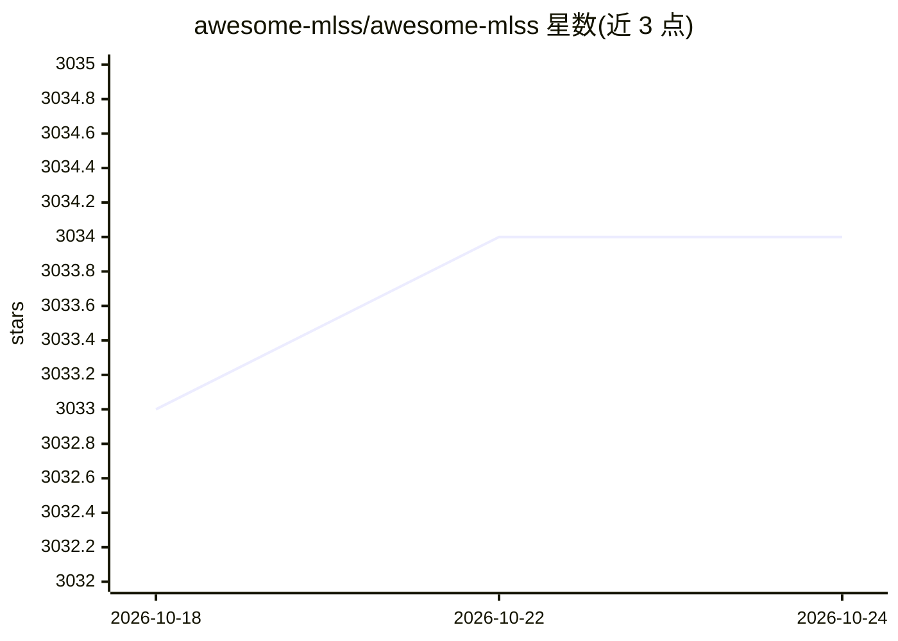

# awesome-mlss/awesome-mlss

⭐ 3,034 · HTML · MIT · 推送 2026-10-20 · [GitHub](https://github.com/awesome-mlss/awesome-mlss) · [官网](https://awesome-mlss.com) · 组织维护

**追踪全球机器学习暑期学校申请截止日期的社区清单**

社区维护的机器学习暑期学校（MLSS）信息聚合项目：作为注册截止日期的中央仓库，收录全球机器学习及相关领域的暑期学校条目，README 中按'即将截止'与'即将开课'分类列出学校名称、主题、地点、截止日期与举办日期，完整名单发布在 awesome-mlss.com 网站，往届学校存于网络档案。接受社区通过 CONTRIBUTING 指南或 issue 提交新条目，也接受组织者邮件投稿。MIT 许可证。

## 筛选速览

| 维度 | 判定 | 备注 |
|---|---|---|
| AI 角色 | `ai-knowledge` | 知识聚合/清单类 |
| 许可风险 | `permissive` | MIT |
| 部署形态 | `None` |  |
| 模型依赖 | — | README 未给出锁定关系 |
| 硬件要求 | — | 无带数字的原话,不猜 |
| 安装摩擦 | `low` | 无编译、无系统依赖或容器化 |
| 成熟度 | — | 结构信号不足 |

## 能力要点

- 按截止日期与开课时间分类的暑期学校条目表
- 完整名单托管于 awesome-mlss.com 网站
- 支持 issue 或邮件方式的社区贡献流程

## 适用场景

- 查找即将截止报名的机器学习暑期学校
- 了解全球 MLSS 的主题、地点与时间安排
- 暑期学校组织者提交自己的学校条目

## 场景标签

`精选清单` · 领域:学习与行业

## 证据(README 行号)

> L7:  A community project to keep track of deadlines for Machine Learning Summer Schools (MLSS) around the world
> L16: awesome-mlss.com is a community tool which serves as a central repository for registration deadlines at summer scho

## 星数曲线

2026-10-18 3,033 → 2026-10-24 3,034（+1）

---
*卡片 v1 · prompt 1.4 · 生成 2026-10-21 · 置信度 high · 依据 README sha `8a3ea8e37d5f` · [字段定义](../../DATASET.md)*
