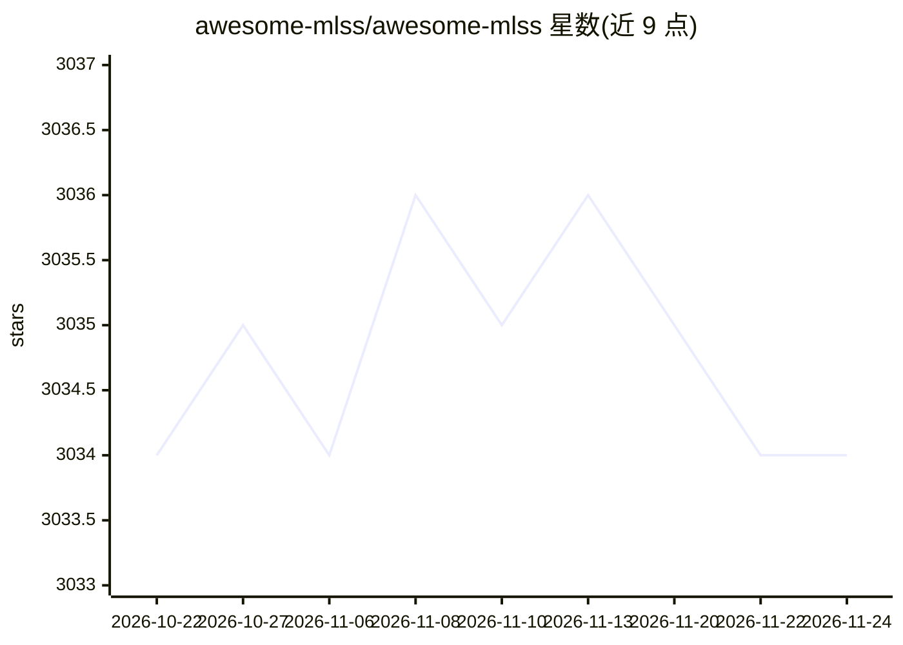

# awesome-mlss/awesome-mlss

⭐ 3,034 · HTML · MIT · 推送 2026-11-23 · [GitHub](https://github.com/awesome-mlss/awesome-mlss) · [官网](https://awesome-mlss.com) · 组织维护

**机器学习暑期学校报名截止日期的社区追踪清单**

社区项目 awesome-mlss，以网站 awesome-mlss.com 与 GitHub 仓库形式追踪全球机器学习及相关领域暑期学校的报名截止日期。README 列出即将举办与截止日期临近的学校条目（含主题、地点、日期），过往学校数据存于网页存档；接受社区以 issue 或 pull request 方式增改条目，组织者可通过邮件提交学校信息。项目基于 aideadlin.es 与 pythondeadlin.es 的成果构建，MIT 许可。

## 筛选速览

| 维度 | 判定 | 备注 |
|---|---|---|
| AI 角色 | `ai-knowledge` | 知识聚合/清单类 |
| 许可风险 | `permissive` | MIT |
| 部署形态 | `None` |  |
| 模型依赖 | — | README 未给出锁定关系 |
| 硬件要求 | — | 无带数字的原话,不猜 |
| 安装摩擦 | `low` | 无编译、无系统依赖或容器化 |
| 成熟度 | — | 结构信号不足 |

## 能力要点

- 集中收录机器学习暑期学校的报名截止日期
- 截止日期临近学校列表可添加到日历
- 支持社区通过 issue 或 PR 增改条目
- 过往学校数据保存于网页存档

## 适用场景

- 查找近期报名截止的机器学习暑期学校
- 作为学生规划申请暑期学校的时间表
- 学校组织者提交自己的学校信息以获得收录

## 场景标签

`精选清单` · 领域:学习与行业

## 证据(README 行号)

> L7:  A community project to keep track of deadlines for Machine Learning Summer Schools (MLSS) around the world
> L16: awesome-mlss.com is a community tool which serves as a central repository for registration deadlines at summer scho
> L22: For the full list of schools worldwide, visit awesome-mlss.com.

## 星数曲线

2026-10-22 3,034 → 2026-11-24 3,034（+0）

---
*卡片 v1 · prompt 1.4 · 生成 2026-11-24 · 置信度 high · 依据 README sha `330cf87abce6` · [字段定义](../../DATASET.md)*
