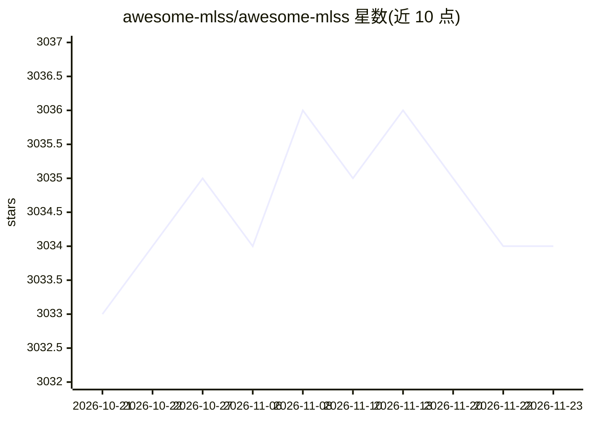

# awesome-mlss/awesome-mlss

⭐ 3,034 · HTML · MIT · 推送 2026-11-16 · [GitHub](https://github.com/awesome-mlss/awesome-mlss) · [官网](https://awesome-mlss.com) · 个人维护

**机器学习暑期学校报名截止日期的聚合追踪站点**

社区维护的机器学习暑期学校（MLSS）信息仓库，作为集中登记全球 MLSS 及相关领域学校报名截止日期的站点，按即将截止、即将开课两周窗口展示条目，含主题、地点、日期与日历添加入口；过刊存档于网页存档，社区可通过 issue 或 PR 提交新增与更新，主办方也可邮件提交。MIT 许可，项目基于 aideadlin.es 与 pythondeadlin.es 的工作构建。

## 筛选速览

| 维度 | 判定 | 备注 |
|---|---|---|
| AI 角色 | `ai-knowledge` | 知识聚合/清单类 |
| 许可风险 | `permissive` | MIT |
| 部署形态 | `None` |  |
| 模型依赖 | — | README 未给出锁定关系 |
| 硬件要求 | — | 无带数字的原话,不猜 |
| 安装摩擦 | `low` | 无编译、无系统依赖或容器化 |
| 成熟度 | — | 结构信号不足 |

## 能力要点

- 集中追踪全球机器学习暑期学校报名截止日期
- 按未来两周截止/开课窗口分栏展示学校条目
- 过刊学校保存在 web archive
- 支持通过 issue/PR 或主办方邮件提交条目

## 适用场景

- 查找近期可报名的机器学习暑期学校
- 添加日历提醒避免错过申请截止日期
- 主办方提交自己的学校信息进行展示

## 场景标签

 · 领域:学术资源/信息聚合

## 证据(README 行号)

> L7:  A community project to keep track of deadlines for Machine Learning Summer Schools (MLSS) around the world
> L16: awesome-mlss.com is a community tool which serves as a central repository for registration deadlines at summer scho

## 星数曲线

2026-10-21 3,033 → 2026-11-23 3,034（+1）

---
*卡片 v1 · prompt 1.4 · 生成 2026-11-23 · 置信度 high · 依据 README sha `1f944cd9337a` · [字段定义](../../DATASET.md)*
