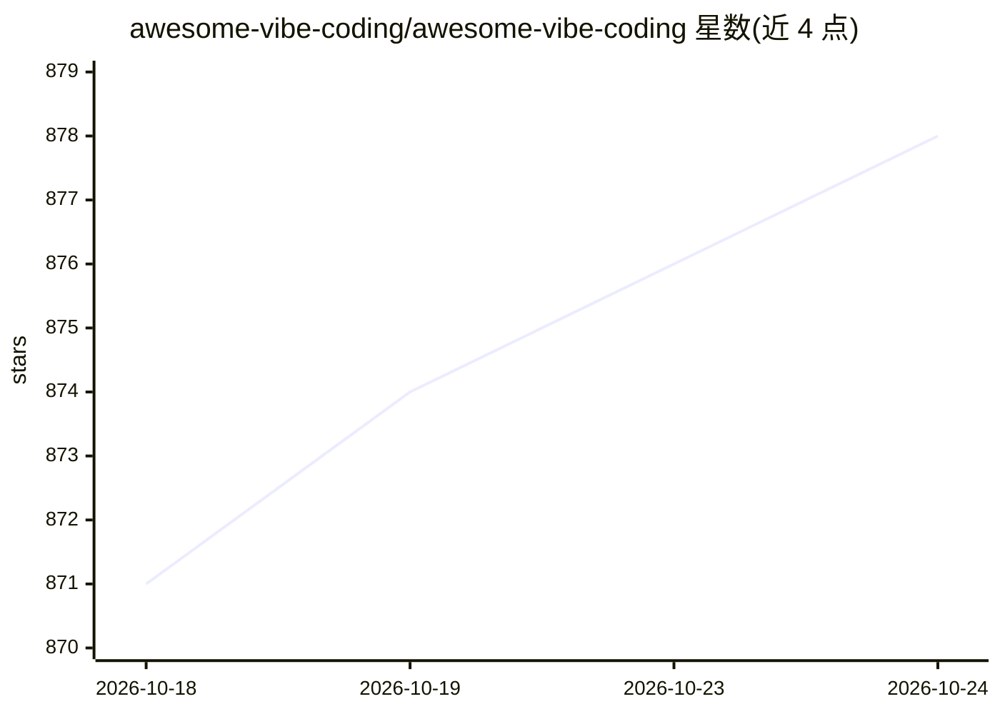

# awesome-vibe-coding/awesome-vibe-coding

⭐ 878 · HTML · CC0-1.0 · 推送 2026-08-13 · [GitHub](https://github.com/awesome-vibe-coding/awesome-vibe-coding) · [官网](https://vibecoding.rest/) · 组织维护

**Vibe Coding 工具与资源精选清单**

人工筛选的 vibe coding（AI 辅助开发）主题 awesome 清单，收录 Web 应用生成器、AI IDE/编辑器、移动端工具、编辑器插件、本地桌面应用、CLI 编码代理、任务管理、成本监控与文档工具等类别条目，并附入门文章与社区链接。条目为第三方工具的名称加一句话描述，由维护者手工挑选；README 含赞助与导流至 AI For Developers 站点的内容。面向使用 AI 进行软件开发的开发者做工具选型参考。

## 筛选速览

| 维度 | 判定 | 备注 |
|---|---|---|
| AI 角色 | `ai-knowledge` | 知识聚合/清单类 |
| 许可风险 | `viral` | CC0-1.0 |
| 部署形态 | `None` |  |
| 模型依赖 | — | README 未给出锁定关系 |
| 硬件要求 | — | 无带数字的原话,不猜 |
| 安装摩擦 | `low` | 无编译、无系统依赖或容器化 |
| 成熟度 | — | 结构信号不足 |

## 能力要点

- 按 Web 构建器/IDE/插件/CLI/任务管理等类别组织条目
- 收录 Karpathy 相关理念说明与多篇入门文章
- 提供可搜索的详细版本（AI For Developers 站点）

## 适用场景

- 挑选 AI 编码编辑器或 CLI 编码代理
- 了解 vibe coding 工具生态与分类
- 查找 AI 编码任务管理与成本追踪工具

## 场景标签

`精选清单` · 领域:学习与行业

## 证据(README 行号)

> L1: # Awesome Vibe Coding Awesome
> L3: > A hand-picked collection of tools and references for building software with the help of AI—through prompts, iterat
> L13: ## Table of Contents

## 星数曲线

2026-10-18 871 → 2026-10-24 878（+7）

---
*卡片 v1 · prompt 1.4 · 生成 2026-10-21 · 置信度 high · 依据 README sha `a4beafc47533` · [字段定义](../../DATASET.md)*
