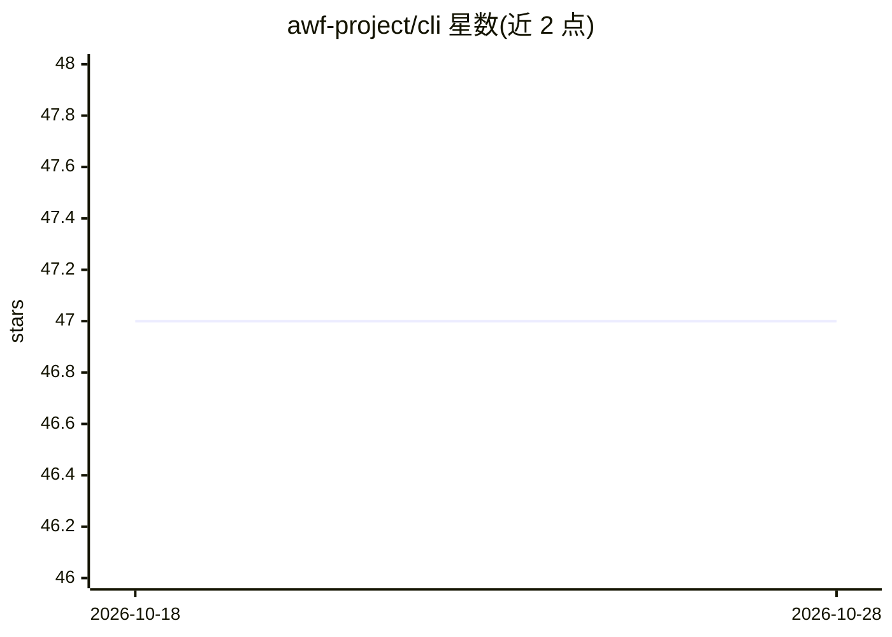

# awf-project/cli

⭐ 47 · Go · EUPL-1.2 · 推送 2026-10-28 · [GitHub](https://github.com/awf-project/cli) · [官网](http://awf-project.ai/cli/) · 组织维护

**用 YAML 工作流编排 AI agent 的 Go 命令行工具**

面向开发者的 Go CLI：以 YAML 定义状态机式工作流，通过 CLI 工具（Claude、Codex、Gemini、GitHub Copilot、Mistral Vibe、OpenCode）或直接 HTTP（OpenAI 兼容 API，含 Ollama、vLLM、Groq）调用 AI agent，支持条件转移、并行、循环、子工作流、重试。关键机制包括 MCP 代理审计 agent 工具调用、JSONL 审计日志与转录、OpenTelemetry 分布式追踪、gRPC 插件系统、TUI 面板与 REST API 服务器。限制：默认无沙箱，agent 与工作流可获 shell 权限，需自行审计来源不明的 YAML。

## 筛选速览

| 维度 | 判定 | 备注 |
|---|---|---|
| AI 角色 | `ai-ecosystem` | LLM/agent 周边工具 |
| 许可风险 | `dual` | EUPL-1.2 |
| 部署形态 | `library` | 以包/库形式分发 |
| 模型依赖 | local-ok | 支持本地模型 |
| 硬件要求 | — | 无带数字的原话,不猜 |
| 安装摩擦 | `medium` | 含编译或系统依赖之一 |
| 成熟度 | — | 结构信号不足 |

## 能力要点

- YAML 状态机工作流：条件转移、并行、循环、子工作流、重试退避
- 通过 CLI 或 OpenAI 兼容 HTTP 接入 Claude/Codex/Gemini/Copilot/Mistral/OpenCode 及 Ollama、vLLM、Groq
- MCP 代理拦截审计 agent 工具调用，含 OTel 追踪与 JSONL 审计日志
- gRPC 插件系统、工作流包分发、TUI 面板与 REST API 服务器

## 适用场景

- 把多步 AI agent 任务编排成可验证、可恢复的工作流
- 通过 MCP 代理审计 AI agent 的工具调用行为
- 以 REST API 或 TUI 监控与执行 agent 工作流

## 场景标签

`Agent 框架` · 领域:Agent 开发

## 证据(README 行号)

> L6: A Go CLI tool for orchestrating AI agents (Claude, Gemini, Codex, GitHub Copilot, Mistral Vibe, OpenCode, OpenAI-Com
> L12: - **Agent Steps** - Invoke AI agents via CLI tools (Claude, Codex, Gemini, GitHub Copilot, Mistral Vibe, OpenCode) 
> L20: - **OpenAI-Compatible Provider** - Use any Chat Completions API (OpenAI, Ollama, vLLM, Groq) with native HTTP integ

## 星数曲线

2026-10-18 47 → 2026-10-28 47（+0）

---
*卡片 v1 · prompt 1.4 · 生成 2026-10-25 · 置信度 high · 依据 README sha `b8208e114ef5` · [字段定义](../../DATASET.md)*
