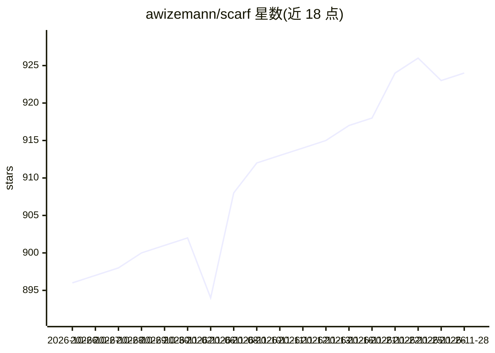

# awizemann/scarf

⭐ 924 · Swift · MIT · 推送 2026-11-26 · [GitHub](https://github.com/awizemann/scarf) · [官网](https://awizemann.github.io/scarf/) · 个人维护 · 中文 README

**给 Hermes AI agent 用的原生 macOS/iOS 图形客户端**

Scarf 是 Hermes 终端/消息 agent 的原生客户端，用 Swift 6/SwiftUI 编写（非 Electron）。提供多窗口多服务器管理：本地 ~/.hermes/ 或经 SSH 连接远程主机；功能覆盖会话浏览与全文搜索、富流式聊天（ACP）或真实终端、token/成本仪表盘、记忆与技能编辑、cron 与 MCP 服务器管理、消息平台配置表单。Hermes 状态只读打开，管理操作经 hermes CLI 写入；按各主机 Hermes 版本做能力门控（v0.6–v0.23）。iOS 伴随应用 ScarfGo 上架 App Store，端上生成 Ed25519 密钥经 SSH 连接。

## 筛选速览

| 维度 | 判定 | 备注 |
|---|---|---|
| AI 角色 | `ai-ecosystem` | LLM/agent 周边工具 |
| 许可风险 | `permissive` | MIT |
| 部署形态 | `desktop` | 安装包/桌面程序 |
| 模型依赖 | — | README 未给出锁定关系 |
| 硬件要求 | — | 无带数字的原话,不猜 |
| 安装摩擦 | `low` | 无编译、无系统依赖或容器化 |
| 成熟度 | — | 结构信号不足 |

## 能力要点

- 多窗口多服务器：本地 + 远程主机经系统 SSH（~/.ssh/config、agent、ProxyJump）
- 富流式聊天（ACP）与真实终端双模式，含工具调用可视化与编辑审批
- token 用量与成本仪表盘、活动热图、会话导出与脱敏
- 按主机 Hermes 版本能力门控 UI，状态只读 + hermes CLI 写入

## 适用场景

- 在 Mac 图形界面管理多台主机上的 Hermes agent
- 通过 iPhone（ScarfGo）随时查看与继续 agent 会话
- 可视化编辑记忆、技能、cron、MCP 服务器等配置

## 场景标签

`AI 助手` · 领域:对话与助手

## 证据(README 行号)

> L5:  The native Mac &amp; iOS app for your Hermes AI agent.
> L37: - **Full control.** Chat with rich streaming (ACP) or a real terminal, edit memory and skills, manage cron, gateway
> L39: - **Native and safe.** Pure Swift 6 / SwiftUI — no Electron. Hermes state is opened read-only; management actions g

## 星数曲线

2026-10-26 896 → 2026-11-28 924（+28）

---
*卡片 v1 · prompt 1.4 · 生成 2026-11-27 · 置信度 high · 依据 README sha `568c60c49061` · [字段定义](../../DATASET.md)*
