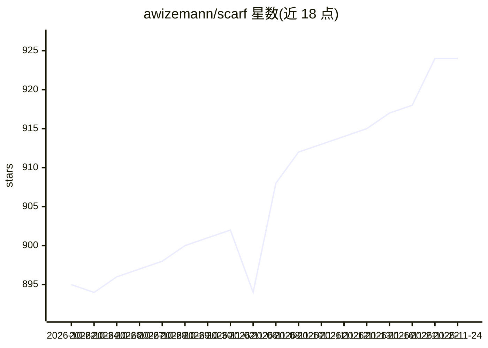

# awizemann/scarf

⭐ 924 · Swift · MIT · 推送 2026-11-09 · [GitHub](https://github.com/awizemann/scarf) · [官网](https://awizemann.github.io/scarf/) · 个人维护 · 中文 README

**Hermes AI agent 的原生 macOS/iOS 图形客户端**

Scarf 是为 Hermes 终端 agent 提供的原生 Swift/SwiftUI 图形界面，覆盖 macOS 与 iOS（ScarfGo）。功能包括会话浏览与全文本搜索、成本与 token 仪表盘、通过 ACP 的富流式聊天或真实终端、memory/skills/cron/MCP 服务器管理、消息平台配置等。支持本地 ~/.hermes/ 及通过 SSH 连接多个远程主机，无中间伴随服务；按所连主机的 Hermes 版本做能力门控（v0.6–v0.21 均可使用）。README 提供 Mac 下载与 App Store 渠道，源码需 Xcode 16+ 构建。

## 筛选速览

| 维度 | 判定 | 备注 |
|---|---|---|
| AI 角色 | `ai-ecosystem` | LLM/agent 周边工具 |
| 许可风险 | `permissive` | MIT |
| 部署形态 | `desktop` | 安装包/桌面程序 |
| 模型依赖 | local-ok | 支持本地模型 |
| 硬件要求 | — | 无带数字的原话,不猜 |
| 安装摩擦 | `low` | 无编译、无系统依赖或容器化 |
| 成熟度 | — | 结构信号不足 |

## 能力要点

- 多窗口多服务器：本地与 SSH 远程主机统一管理，无中间服务
- 会话、工具调用、token 与成本的仪表盘、搜索与导出
- ACP 富流式聊天 + SwiftTerm 真实终端两种交互模式
- 按主机 Hermes 版本做 UI 能力门控，兼容 v0.6–v0.21

## 适用场景

- 在 Mac GUI 中查看和管理运行在远程服务器上的 Hermes agent
- 通过 iPhone (ScarfGo) 随时查看会话、编辑 memory、管理 cron
- 用仪表盘追踪 agent 的 token 消耗与费用明细

## 场景标签

 · 领域:AI agent 工具/客户端

## 证据(README 行号)

> L5:  The native Mac &amp; iOS app for your Hermes AI agent.
> L28: Hermes is a terminal-and-messaging agent — powerful, but invisible. Scarf gives it a face:
> L31: - **Full control.** Chat with rich streaming (ACP) or a real terminal, edit memory and skills, manage cron, gateway

## 星数曲线

2026-10-22 895 → 2026-11-24 924（+29）

---
*卡片 v1 · prompt 1.4 · 生成 2026-11-24 · 置信度 high · 依据 README sha `68c72169eca6` · [字段定义](../../DATASET.md)*
