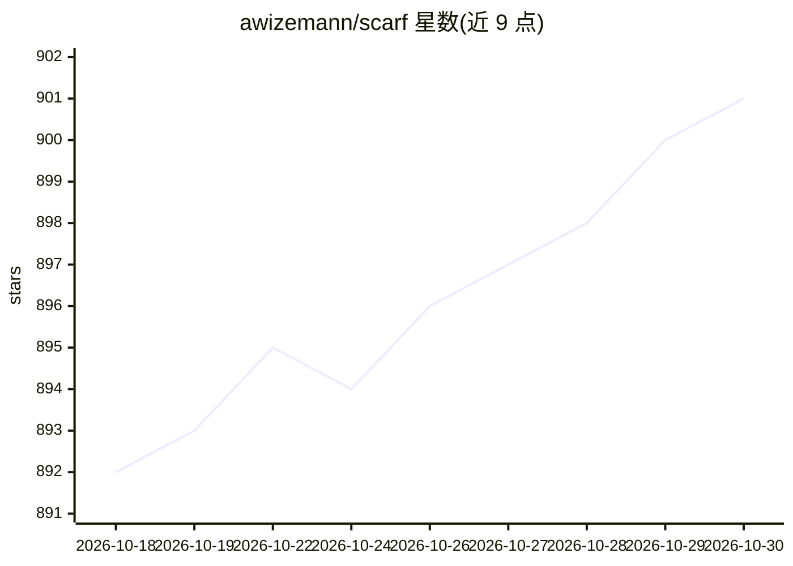

# awizemann/scarf

⭐ 901 · Swift · MIT · 推送 2026-10-28 · [GitHub](https://github.com/awizemann/scarf) · [官网](https://awizemann.github.io/scarf/) · 个人维护 · 中文 README

**Hermes AI agent 的原生 macOS/iOS 图形客户端**

用 Swift 6/SwiftUI 编写的桌面与手机应用，为终端型 agent 框架 Hermes 提供 GUI：多窗口多服务器（本地 ~/.hermes/ 与 SSH 远程），覆盖聊天（ACP 富流式或真终端）、会话历史与全文搜索、项目仪表盘、看板、memory/skill 编辑、cron、MCP 服务器管理、消息平台配置、模型选择（含 Ollama/LM Studio/vLLM/llama.cpp 本地模型发现）与 OpenAI 兼容代理。Hermes 状态只读打开，管理操作经 hermes CLI；按主机版本做能力门控，兼容 Hermes v0.6–v0.21。要求 macOS 15+/iOS 18.6+，Mac 版可下载安装包或从源码构建。

## 筛选速览

| 维度 | 判定 | 备注 |
|---|---|---|
| AI 角色 | `ai-ecosystem` | LLM/agent 周边工具 |
| 许可风险 | `permissive` | MIT |
| 部署形态 | `desktop` | 安装包/桌面程序 |
| 模型依赖 | — | README 未给出锁定关系 |
| 硬件要求 | — | 无带数字的原话,不猜 |
| 安装摩擦 | `low` | 无编译、无系统依赖或容器化 |
| 成熟度 | — | 结构信号不足 |

## 能力要点

- 多窗口多服务器：本地与 SSH 远程主机统一操作，无需中间伴生服务
- Rich Chat（ACP 协议流式）与真终端两种聊天模式，支持会话恢复与自动重连
- 项目驾驶舱：agent 生成的 JSON 仪表盘、看板、Mini-apps、Fleet 配置漂移检测
- Hermes 状态只读打开，写操作经 hermes CLI，避免损坏 agent 数据

## 适用场景

- 给终端里跑的 Hermes agent 装一个图形界面，看会话、成本与工具调用
- 从 iPhone 经 SSH 管理和对话远程服务器上的 Hermes
- 在 GUI 里管理 MCP、cron、消息平台与模型配置，替代编辑 YAML

## 场景标签

`聊天机器人` · 领域:对话与助手

## 证据(README 行号)

> L5:  The native Mac &amp; iOS app for your Hermes AI agent.
> L31: - **Full control.** Chat with rich streaming (ACP) or a real terminal, edit memory and skills, manage cron, gateway
> L92: - **Chat** — two modes: **Rich Chat** streams over the Agent Client Protocol (ACP) with markdown, tool-call visuali

## 星数曲线

2026-10-18 892 → 2026-10-30 901（+9）

---
*卡片 v1 · prompt 1.4 · 生成 2026-10-21 · 置信度 high · 依据 README sha `7f6e3d45e2c5` · [字段定义](../../DATASET.md)*
