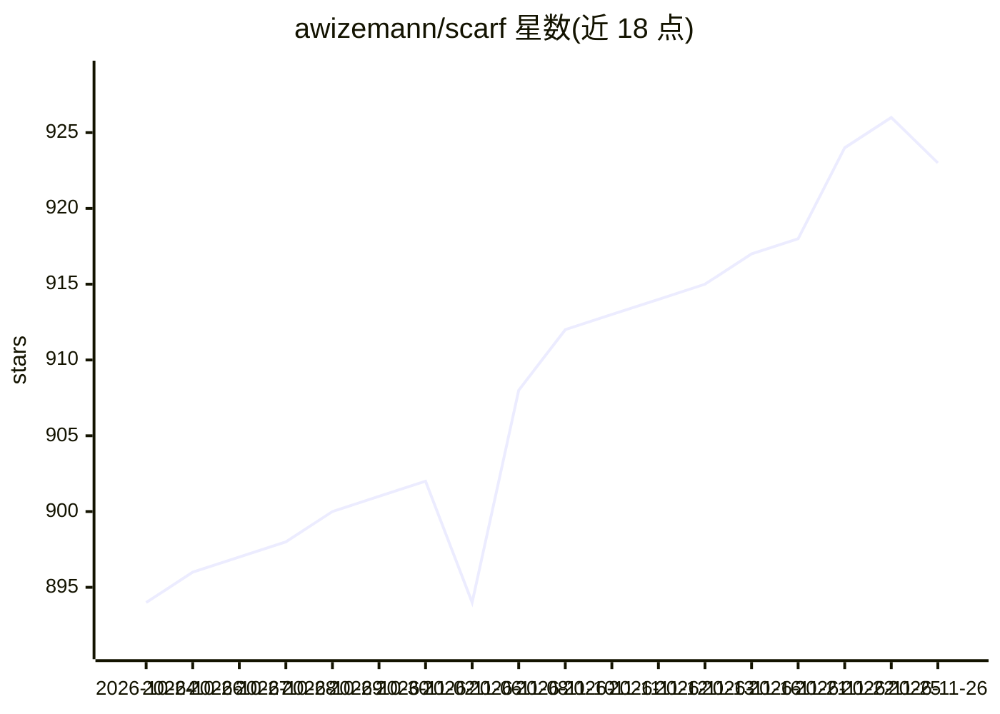

# awizemann/scarf

⭐ 923 · Swift · MIT · 推送 2026-11-25 · [GitHub](https://github.com/awizemann/scarf) · [官网](https://awizemann.github.io/scarf/) · 个人维护 · 中文 README

**给 Hermes AI agent 用的原生 macOS/iOS 管理客户端**

Scarf 是 Hermes 终端代理的原生 Swift/SwiftUI 客户端，提供会话查看、富流式聊天（ACP）或内置终端、内存/技能编辑、cron 与 MCP 服务器管理、用量与成本仪表盘；通过本地 ~/.hermes/ 或 SSH 连接任意多台远程主机，无中间服务，状态只读、管理操作经 hermes CLI 写入，并按主机 Hermes 版本做能力门控。iOS 端 ScarfGo 提供手机访问、设备端语音转写与端上生成的 SSH 密钥。

## 筛选速览

| 维度 | 判定 | 备注 |
|---|---|---|
| AI 角色 | `ai-ecosystem` | LLM/agent 周边工具 |
| 许可风险 | `permissive` | MIT |
| 部署形态 | `desktop` | 安装包/桌面程序 |
| 模型依赖 | local-ok | 支持本地模型 |
| 硬件要求 | — | 无带数字的原话,不猜 |
| 安装摩擦 | `low` | 无编译、无系统依赖或容器化 |
| 成熟度 | — | 结构信号不足 |

## 能力要点

- 多窗口多服务器：本地与 SSH 远程主机一视同仁，SQLite 经原子快照读取
- Hermes 版本检测与能力门控 UI（v0.6–v0.23）
- 全量管理面：memory/skills/cron/MCP/网关/webhooks/config.yaml 编辑器
- ScarfGo 端上语音转写，Ed25519 密钥生成并存储于 iOS Keychain

## 适用场景

- 在图形界面查看和管理 Hermes agent 的会话、技能与定时任务
- 从 iPhone 经 SSH 访问自己服务器上的 Hermes
- 跟踪 agent 的 token 用量与按模型成本分解

## 场景标签

`语音识别` · 领域:感知与多模态

## 证据(README 行号)

> L5:  The native Mac &amp; iOS app for your Hermes AI agent.
> L31: - **Full control.** Chat with rich streaming (ACP) or a real terminal, edit memory and skills, manage cron, gateway

## 星数曲线

2026-10-24 894 → 2026-11-26 923（+29）

---
*卡片 v1 · prompt 1.4 · 生成 2026-11-26 · 置信度 high · 依据 README sha `f52368a9705f` · [字段定义](../../DATASET.md)*
