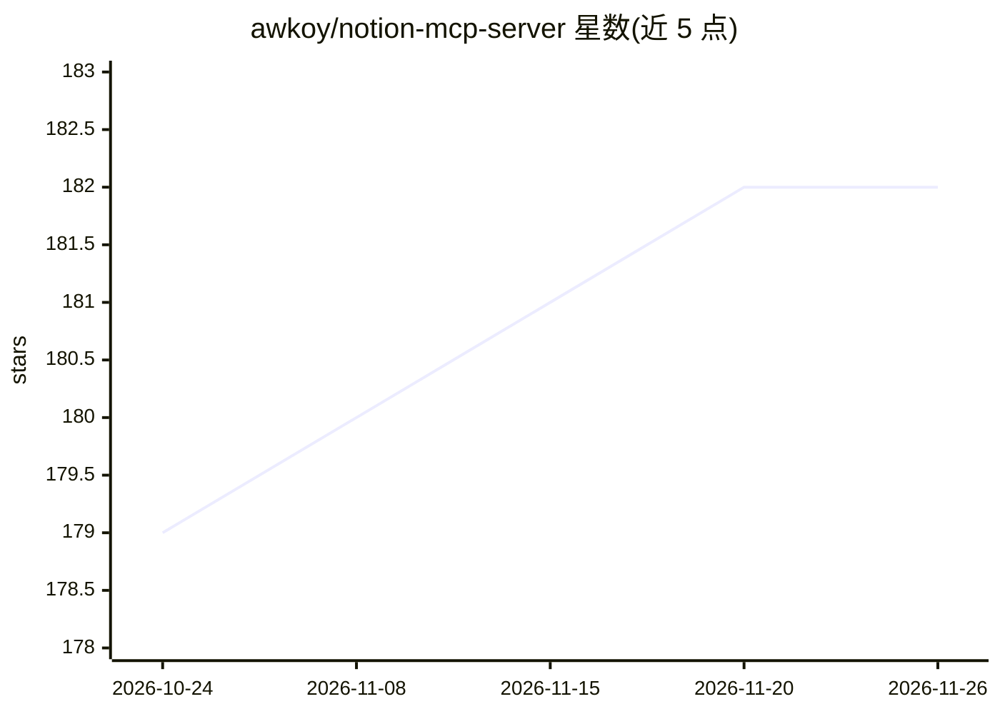

# awkoy/notion-mcp-server

⭐ 182 · TypeScript · MIT · 推送 2026-11-25 · [GitHub](https://github.com/awkoy/notion-mcp-server) · [官网](https://www.npmjs.com/package/notion-mcp-server) · 个人维护

**让 Claude/Cursor 等 MCP 客户端用 token 读写 Notion 的服务器**

一个 Model Context Protocol 服务器，通过 Notion token 鉴权向 Claude Code、Claude Desktop、Cursor、VS Code、Codex 等 MCP 客户端提供 Notion 的读写能力，覆盖页面、数据库、评论与文件上传。提供 3 个工具，连接时占用约 1,005 tokens；支持批量写入（原子回滚与幂等键）、限流重试、markdown 输入输出，以及只读/操作黑白名单等环境变量约束。无需浏览器登录，可在 CI、cron、服务器等无界面环境运行，支持 stdio 与 HTTP 传输，提供 npm 与 Docker 分发。

## 筛选速览

| 维度 | 判定 | 备注 |
|---|---|---|
| AI 角色 | `ai-ecosystem` | LLM/agent 周边工具 |
| 许可风险 | `permissive` | MIT |
| 部署形态 | `self-host` | docker 或自建部署 |
| 模型依赖 | — | README 未给出锁定关系 |
| 硬件要求 | — | 无带数字的原话,不猜 |
| 安装摩擦 | `low` | 无编译、无系统依赖或容器化 |
| 成熟度 | — | 结构信号不足 |

## 能力要点

- 3 个工具实现对 Notion 页面/数据库/评论/文件的读写与上传
- token 鉴权适用于全部 Notion 计划（含 Free），可无界面运行
- 批量写入带原子回滚与幂等键，限流自动重试
- 只读模式、操作黑白名单与破坏性操作确认等安全约束

## 适用场景

- 让 AI 助手批量重命名或整理我的 Notion 页面
- 在 CI 或后台 agent 中无人值守地查询与更新 Notion 数据库
- 把截图或文档从本地/URL 上传到指定 Notion 页面

## 场景标签

 · 领域:LLM 基础设施/MCP 工具集成

## 证据(README 行号)

> L7: **notion-mcp-server** is a Model Context Protocol (MCP) server that gives Claude Code, Claude Desktop, Cursor, VS Co
> L9: - **Token auth on every Notion plan, Free included.** No browser sign-in, so it also runs headless: in CI, cron jobs
> L103: |**This server**|Agents, automation, CI, self-hosting, long sessions|Token, every plan|✅|Actively maintained; 3 to

## 星数曲线

2026-10-24 179 → 2026-11-26 182（+3）

---
*卡片 v1 · prompt 1.4 · 生成 2026-11-26 · 置信度 high · 依据 README sha `591fbc5fd416` · [字段定义](../../DATASET.md)*
