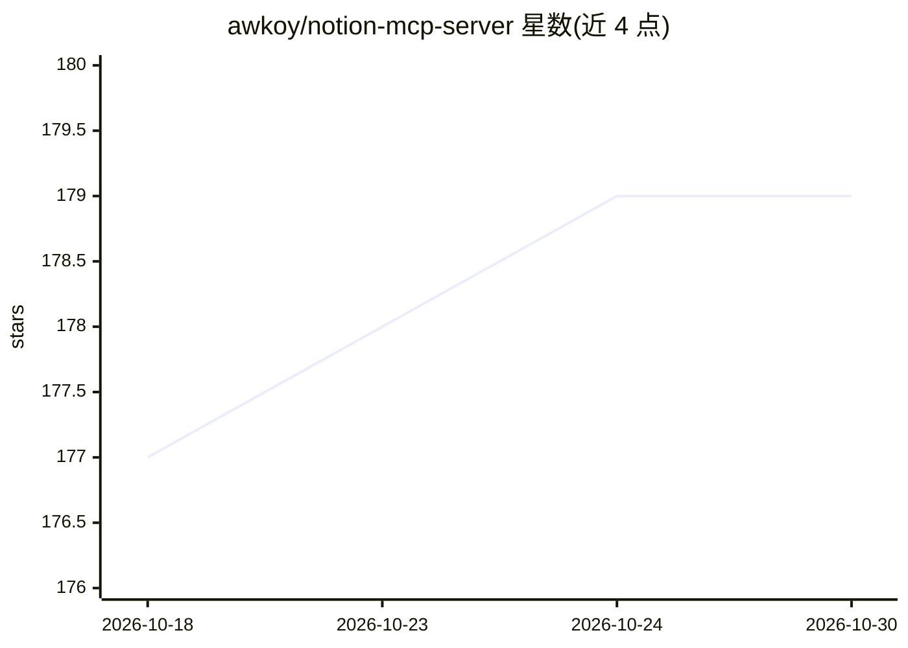

# awkoy/notion-mcp-server

⭐ 179 · TypeScript · MIT · 推送 2026-10-28 · [GitHub](https://github.com/awkoy/notion-mcp-server) · [官网](https://www.npmjs.com/package/notion-mcp-server) · 个人维护

**MCP 服务器：用单个 Notion token 让各类 AI 客户端读写 Notion**

基于 Model Context Protocol 的 Notion 连接服务器：通过 Personal Access Token 或内部集成 token 鉴权，使 Claude Code、Claude Desktop、Cursor、VS Code、Codex 等 MCP 客户端能搜索、创建、编辑页面，查询数据库，添加评论与上传文件。提供 3 个工具覆盖 46 种操作，支持批量写入（原子回滚、幂等键）、限速重试、markdown 往返；可运行于 stdio 或 HTTP 传输，支持 Docker 与无头环境（CI/cron）。对比表格中列出了与 Notion 官方托管及开源服务器的差异。

## 筛选速览

| 维度 | 判定 | 备注 |
|---|---|---|
| AI 角色 | `ai-ecosystem` | LLM/agent 周边工具 |
| 许可风险 | `permissive` | MIT |
| 部署形态 | `self-host` | docker 或自建部署 |
| 模型依赖 | — | README 未给出锁定关系 |
| 硬件要求 | — | 无带数字的原话,不猜 |
| 安装摩擦 | `low` | 无编译、无系统依赖或容器化 |
| 成熟度 | — | 结构信号不足 |

## 能力要点

- 单一 token 鉴权，兼容所有 Notion 套餐（含免费版），支持无头运行
- 3 个工具覆盖 46 种操作，批量写入带原子回滚与幂等键
- 读写分离的细粒度操作权限（allowlist/blocklist、只读模式、破坏性操作确认）
- 支持 stdio 与 Streamable HTTP 两种传输，Docker 部署

## 适用场景

- 让 Claude Code 或 Cursor 在对话中直接读写我的 Notion 页面和数据库
- 在 CI 或定时任务中让无人值守 agent 操作 Notion
- 自建 HTTP 端点供多个网络化 agent 共享访问 Notion

## 场景标签

 · 领域:LLM 基础设施/MCP 工具

## 证据(README 行号)

> L7: **notion-mcp-server** is a Model Context Protocol (MCP) server that gives Claude Code, Claude Desktop, Cursor, VS Co
> L46:  Manual setup: JSON config, Claude Code, Codex, Gemini CLI, Docker
> L162: The server speaks stdio by default. Set `MCP_TRANSPORT=http` to run it as a Streamable HTTP endpoint for web clien

## 星数曲线

2026-10-18 177 → 2026-10-30 179（+2）

---
*卡片 v1 · prompt 1.4 · 生成 2026-10-23 · 置信度 high · 依据 README sha `1ff54d0f06e9` · [字段定义](../../DATASET.md)*
