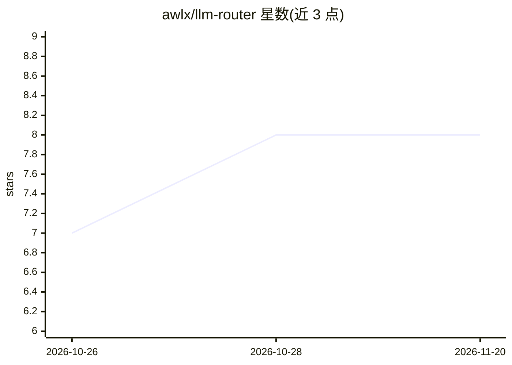

# awlx/llm-router

⭐ 8 · Go · MIT · 推送 2026-10-25 · [GitHub](https://github.com/awlx/llm-router) · 个人维护

**面向多模型服务器的 OpenAI 兼容路由代理**

用 Go 编写的透明反向代理：读取各后端服务器的模型列表，按模型 ID 将请求转发到匹配服务器，模型名与请求体保持不变。支持流式、chat completions、completions、responses 和 embeddings 端点，重复模型 ID 直接拒绝。提供客户端 API key 鉴权、CORS 配置、优雅关闭、Prometheus /metrics 指标与 Grafana 面板。不提供负载均衡、failover、音频路由与内置 TLS。安装方式包括 APT 包、Docker 镜像、二进制包与源码编译。

## 筛选速览

| 维度 | 判定 | 备注 |
|---|---|---|
| AI 角色 | `ai-ecosystem` | LLM/agent 周边工具 |
| 许可风险 | `permissive` | MIT |
| 部署形态 | `self-host` | docker 或自建部署 |
| 模型依赖 | local-ok | 支持本地模型 |
| 硬件要求 | — | 无带数字的原话,不猜 |
| 安装摩擦 | `low` | 无编译、无系统依赖或容器化 |
| 成熟度 | — | 结构信号不足 |

## 能力要点

- OpenAI 兼容路由：按模型列表自动发现并转发请求
- 支持流式、chat/completions/responses/embeddings 端点
- 内置 Prometheus 指标（含首字节延迟）与 Grafana 面板
- 客户端 API key 鉴权、CORS、systemd 服务与 Docker 部署

## 适用场景

- 多个模型服务器用一个 API 地址统一接入
- 为 LLM 服务接入 Prometheus 监控与 Grafana 面板
- 浏览器应用通过 CORS 配置调用本地模型服务

## 场景标签

`模型网关` · 领域:Agent 开发

## 证据(README 行号)

> L3: Use one API address for several model servers.
> L4: The router reads each server's model list and sends requests to the matching server.
> L6: - Works with vLLM, TensorFold and LM Studio.

## 星数曲线

2026-10-26 7 → 2026-11-20 8（+1）

---
*卡片 v1 · prompt 1.4 · 生成 2026-11-20 · 置信度 high · 依据 README sha `f870726980ee` · [字段定义](../../DATASET.md)*
