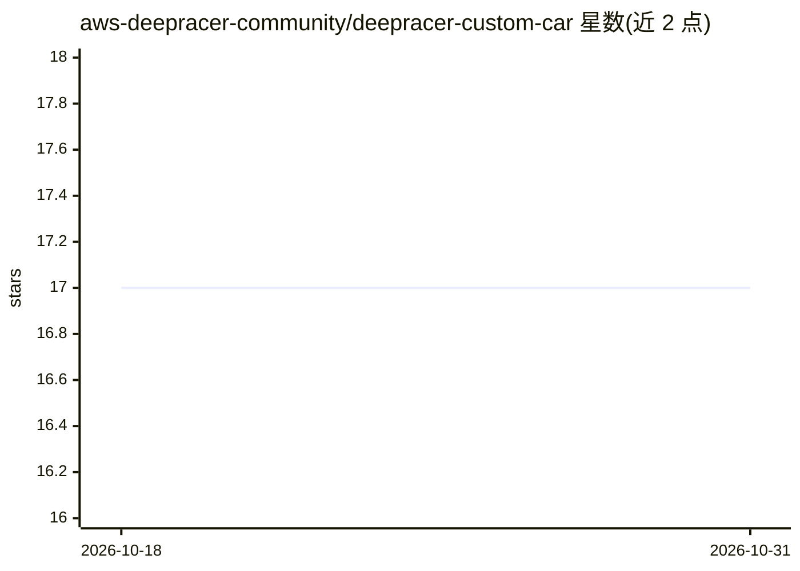

# aws-deepracer-community/deepracer-custom-car

⭐ 17 · Python · MIT · 推送 2026-10-17 · [GitHub](https://github.com/aws-deepracer-community/deepracer-custom-car) · 组织维护

**DeepRacer/树莓派小车的自定义 ROS2 软件栈**

为 AWS DeepRacer 原车及树莓派 4/5 自制兼容小车提供的替换软件栈：构建与安装脚本、自定义控制台、推理引擎选择（OpenVINO CPU/GPU/NCS2 或 TensorFlow Lite）、差速驱动支持、ROS Bag 日志记录与车辆健康分析。同时包含用 WLToys A979 与树莓派搭建兼容小车的图纸和组装说明，以及为原车刷机的 USB 工具。安装基于预打包 apt/deb 包，无需在车上编译。

## 筛选速览

| 维度 | 判定 | 备注 |
|---|---|---|
| AI 角色 | `ai-ecosystem` | LLM/agent 周边工具 |
| 许可风险 | `permissive` | MIT |
| 部署形态 | `None` |  |
| 模型依赖 | — | README 未给出锁定关系 |
| 硬件要求 | — | 无带数字的原话,不猜 |
| 安装摩擦 | `low` | 无编译、无系统依赖或容器化 |
| 成熟度 | — | 结构信号不足 |

## 能力要点

- 支持原车、树莓派 4/5，含 Ubuntu 24.04 与 ROS2 Jazzy
- 推理引擎可选 TFLite 或 OpenVINO（CPU/GPU/NCS2）
- 差速驱动电机可选替代标准舵机底盘
- 推理结果与相机画面自动记录为 ROS Bag，含 Python 与 C++ 日志节点

## 适用场景

- 给原版 DeepRacer 换用社区维护的软件栈
- 用树莓派和 WLToys A979 自制 DeepRacer 兼容小车
- 记录小车推理与相机数据用于赛后分析

## 场景标签

 · 领域:机器人/自动驾驶小车

## 证据(README 行号)

> L8:  - Build and install scripts for a custom ROS2 software stack for DeepRacer, supporting original DeepRacer, Raspberr
> L21: - Inference using OpenVINO with Intel GPU (original DeepRacer), OpenVINO with Myriad Neural Compute Stick (NCS), or
> L64: |`inference_engine`|`TFLITE`|Inference engine to use (`TFLITE` or `OV`).|

## 星数曲线

2026-10-18 17 → 2026-10-31 17（+0）

---
*卡片 v1 · prompt 1.4 · 生成 2026-10-29 · 置信度 high · 依据 README sha `71790bbf69a6` · [字段定义](../../DATASET.md)*
