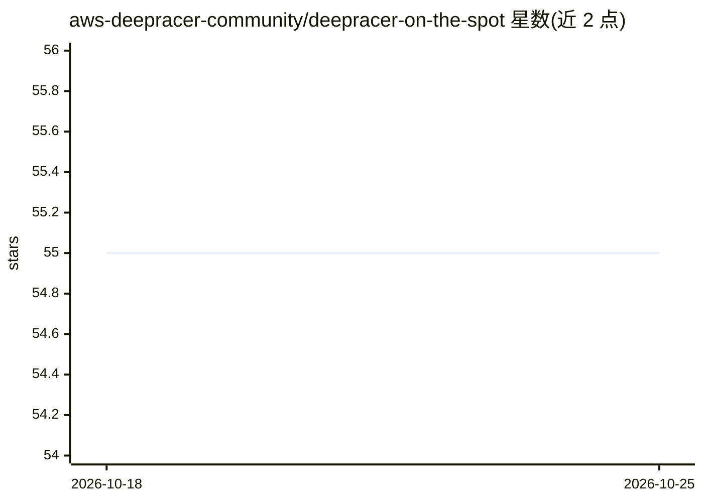

# aws-deepracer-community/deepracer-on-the-spot

⭐ 55 · TypeScript · Apache-2.0 · 推送 2026-10-24 · [GitHub](https://github.com/aws-deepracer-community/deepracer-on-the-spot) · 组织维护

**用 EC2/Spot 实例运行 DeepRacer 训练的 CloudFormation 模板集**

围绕 deepracer-for-cloud 项目封装的一组 bash 脚本与 CloudFormation 模板：在 AWS 上自动创建 S3、SNS、IAM 等前置资源，一键拉起按需或 Spot EC2 实例（默认 g4dn.2xlarge）进行 DeepRacer 强化学习训练，支持定时终止、Spot 中断后自动恢复续训、训练完成后将模型导入 AWS DeepRacer 控制台，并附 menu.sh 菜单、训练视频与安全终止/访问控制等辅助脚本。面向希望在 DeepRacer 控制台之外以更低成本、更多并发训练模型的 AWS 用户。

## 筛选速览

| 维度 | 判定 | 备注 |
|---|---|---|
| AI 角色 | `ai-ecosystem` | LLM/agent 周边工具 |
| 许可风险 | `permissive` | Apache-2.0 |
| 部署形态 | `None` |  |
| 模型依赖 | — | README 未给出锁定关系 |
| 硬件要求 | — | 无带数字的原话,不猜 |
| 安装摩擦 | `low` | 无编译、无系统依赖或容器化 |
| 成熟度 | — | 结构信号不足 |

## 能力要点

- 一键创建按需/Spot EC2 实例并自动启动 DeepRacer 训练
- Spot 中断时经 Auto Scaling 组自动重建实例并续训
- 训练完成后可自动导入 AWS DeepRacer 控制台
- menu.sh 交互菜单管理训练、配置与脚本

## 适用场景

- 以 Spot 实例低成本训练 DeepRacer 模型
- 在 EC2 上并发训练多个模型并自定义 action space
- 定时启停训练并自动上传/导入模型

## 场景标签

`强化学习` · 领域:训练与推理

## 证据(README 行号)

> L2: Simple cloudformation templates to assist in creating ec2 instances for deep racer learning, with automated training
> L45: The primary purpose of this template is to provide a simple single script to run that sets up all of the prerequisi

## 星数曲线

2026-10-18 55 → 2026-10-25 55（+0）

---
*卡片 v1 · prompt 1.4 · 生成 2026-10-24 · 置信度 high · 依据 README sha `3cbe347c155c` · [字段定义](../../DATASET.md)*
