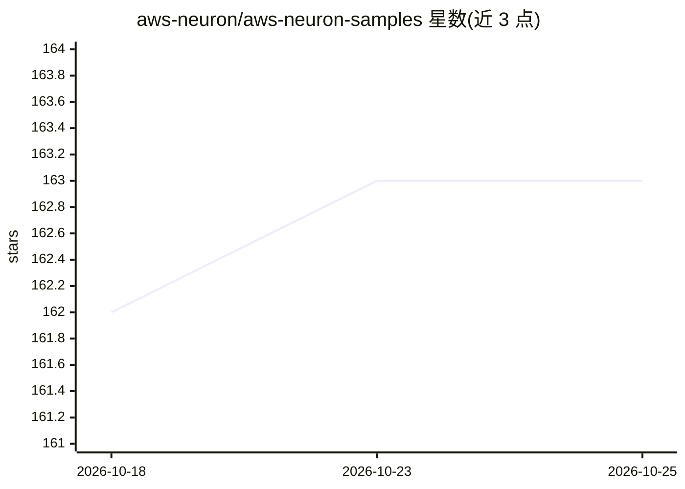

# aws-neuron/aws-neuron-samples

⭐ 163 · Jupyter Notebook · NOASSERTION · 推送 2026-07-15 · [GitHub](https://github.com/aws-neuron/aws-neuron-samples) · 组织维护

**面向 AWS Neuron SDK 开发者的推理/训练示例代码集合**

AWS Neuron 团队维护的示例代码仓库：Neuron SDK 用于在 AWS 自研加速芯片 Inferentia 与 Trainium 上运行机器学习推理和训练负载。仓库按用途（训练/推理）与框架（PyTorch 的 torch-neuronx/torch-neuron、TensorFlow 的 tensorflow-neuron）组织示例脚本与 Jupyter notebook，另包含与 SageMaker、EKS、ParallelCluster、Nemo Megatron 搭配的使用示例，并注明各示例对应的实例类型（Trn1/Trn1n/Inf1/Inf2）。README 声明示例不代表支持的模型全集，Known Issues 列出部分模型在 Inf1 上编译失败的情况。

## 筛选速览

| 维度 | 判定 | 备注 |
|---|---|---|
| AI 角色 | `ai-ecosystem` | LLM/agent 周边工具 |
| 许可风险 | `none` | NOASSERTION |
| 部署形态 | `None` |  |
| 模型依赖 | — | README 未给出锁定关系 |
| 硬件要求 | — | 无带数字的原话,不猜 |
| 安装摩擦 | `low` | 无编译、无系统依赖或容器化 |
| 成熟度 | — | 结构信号不足 |

## 能力要点

- 按训练/推理与 PyTorch/TensorFlow 框架组织的示例脚本与 notebook
- 覆盖 torch-neuronx、transformers-neuronx、tensorflow-neuron 等多条 SDK 通道
- 包含 SageMaker、EKS、ParallelCluster 集成使用示例
- 标注每个示例对应的实例类型（Trn1/Trn1n/Inf1/Inf2）

## 适用场景

- 在 Inferentia/Trainium 实例上训练或推理时查找参考实现
- 了解特定模型在 Neuron 上的编译与运行可行性
- 参考 SageMaker/EKS 场景下使用 Neuron 的部署模式

## 场景标签

 · 领域:ML 基础设施/专用加速器

## 证据(README 行号)

> L3: This repository contains samples for AWS Neuron, the software development kit (SDK) that enables machine learning (M
> L7: Samples are organized by use case (training, inference) and deep learning framework (PyTorch, TensorFlow) below:

## 星数曲线

2026-10-18 162 → 2026-10-25 163（+1）

---
*卡片 v1 · prompt 1.4 · 生成 2026-10-22 · 置信度 high · 依据 README sha `0f2585bf9f77` · [字段定义](../../DATASET.md)*
