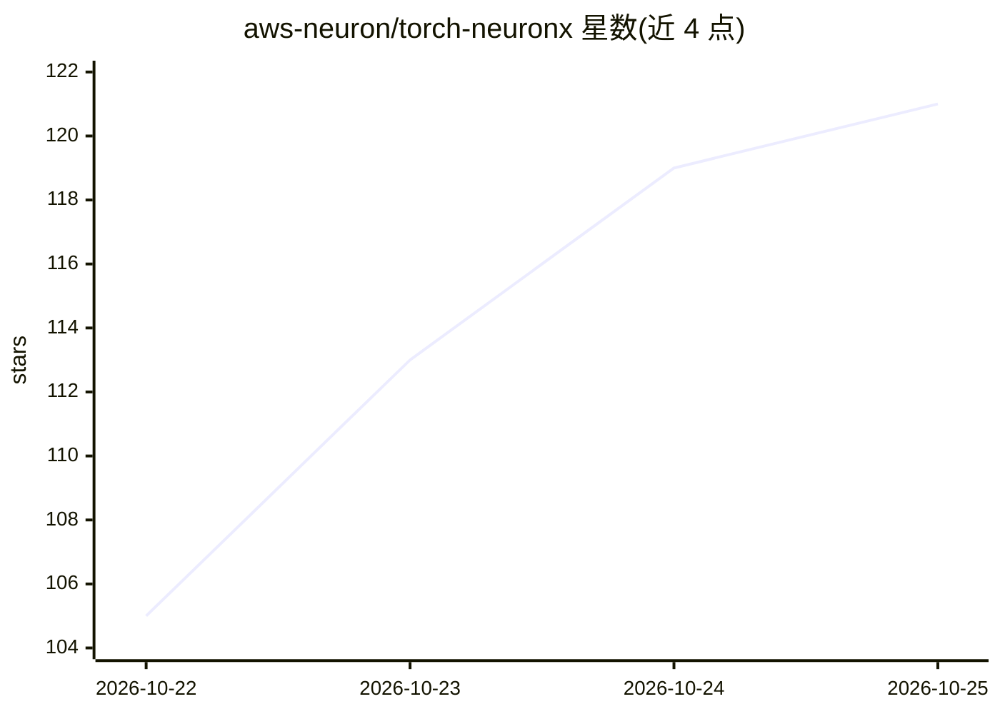

# aws-neuron/torch-neuronx

⭐ 121 · Python · Apache-2.0 · 推送 2026-10-20 · [GitHub](https://github.com/aws-neuron/torch-neuronx) · [官网](https://awsdocs-neuron.readthedocs-hosted.com/en/latest/torch/index.html) · 组织维护

**面向 AWS Trainium 的 PyTorch 原生后端（neuron 设备）**

通过 PrivateUse1 机制为上游 PyTorch 添加 `neuron` 设备，使现有 PyTorch API 可直接在 AWS Trainium（Trn2/Trn3 实例）上训练和推理。默认支持 eager 执行，可选 `torch.compile` 图编译、`torch.distributed`/DTensor/FSDP 分布式训练，并可在 PyTorch 代码中调用 NKI 自定义内核。已知限制包括仅支持静态形状、float64 按 float32 运行、FlexAttention 支持有限等。需 Neuron SDK 2.33 与 Python 3.12–3.14，当前为 Beta。

## 筛选速览

| 维度 | 判定 | 备注 |
|---|---|---|
| AI 角色 | `ai-ecosystem` | LLM/agent 周边工具 |
| 许可风险 | `permissive` | Apache-2.0 |
| 部署形态 | `library` | 以包/库形式分发 |
| 模型依赖 | — | README 未给出锁定关系 |
| 硬件要求 | — | 无带数字的原话,不猜 |
| 安装摩擦 | `low` | 无编译、无系统依赖或容器化 |
| 成熟度 | `idea` | |

## 能力要点

- 以 PrivateUse1 机制注册 `neuron` 设备，复用原生 PyTorch API
- 支持 eager 执行、`torch.compile` 图编译与持久化编译缓存
- DTensor / functional collectives / FSDP 分布式训练支持
- NKI 自定义内核可在 eager 与 `torch.compile` 图内调用

## 适用场景

- 在 Trainium 实例上以原生 PyTorch API 训练模型
- 用 `torch.compile` 编译模型区域以提升 Neuron 上的性能
- 编写 NKI 自定义算子并集成进 PyTorch 计算图

## 场景标签

`模型训练` `推理引擎` · 领域:训练与推理

## 证据(README 行号)

> L3: torch-neuronx is the native PyTorch backend for AWS Trainium. It adds a `neuron` device to upstream PyTorch through 
> L5: - **Eager by default.** Operations run one at a time on the device, as they do on any other PyTorch device. There is

## 星数曲线

2026-10-22 105 → 2026-10-25 121（+16）

---
*卡片 v1 · prompt 1.4 · 生成 2026-10-23 · 置信度 high · 依据 README sha `deebd8acacf3` · [字段定义](../../DATASET.md)*
