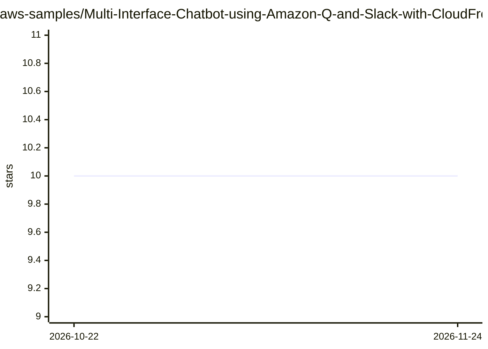

# aws-samples/Multi-Interface-Chatbot-using-Amazon-Q-and-Slack-with-CloudFront-Clickable-References

⭐ 10 · Python · MIT-0 · 推送 2026-04-13 · [GitHub](https://github.com/aws-samples/Multi-Interface-Chatbot-using-Amazon-Q-and-Slack-with-CloudFront-Clickable-References) · 组织维护

**基于 Amazon Q 与 Slack 的 RAG 知识问答机器人**

AWS 官方示例工程，用 CDK 部署一套 RAG 聊天机器人：数据处理栈将 Spack 文档与历史 Slack 对话转成 markdown 并生成元数据，由 Kendra 做语义检索；Slack 端经 API Gateway 调用 Lambda，Amazon Q Business 端作为托管助手，两条入口共享同一向量数据源。回答附带 CloudFront 可点击来源链接，并提供 CloudWatch 调用量看板与每日 Slack 用量报告。部署需 AWS 账号、Docker、AWS CLI 与 Slack 工作区。

## 筛选速览

| 维度 | 判定 | 备注 |
|---|---|---|
| AI 角色 | `ai-native` | 本体是模型或模型工具 |
| 许可风险 | `permissive` | MIT-0 |
| 部署形态 | `library` | 以包/库形式分发 |
| 模型依赖 | locked-api |  |
| 硬件要求 | — | 无带数字的原话,不猜 |
| 安装摩擦 | `low` | 无编译、无系统依赖或容器化 |
| 成熟度 | — | 结构信号不足 |

## 能力要点

- Slack 与 Amazon Q 双入口共享同一 Kendra 检索数据源
- 回答附带 CloudFront 可点击来源链接
- 每日自动摄取过去 24 小时 Slack 对话并同步索引
- CloudWatch 看板与每日 Slack 用量报告

## 适用场景

- 为开源项目文档与社区 Slack 历史搭建问答机器人
- 在 Slack 内让用户查询带来源链接的知识问答
- 在 AWS 上托管的内部知识助手需统计调用量

## 场景标签

`聊天机器人` `RAG` · 领域:对话与助手

## 证据(README 行号)

> L5: This innovative chatbot that employs Retrieval-Augmented Generation (RAG) technology to provide responses
> L54: generative-AI powered assistant tailored for this use case to answer questions based on the data from the data stac
> L63:  1. Slack app invokes `API Gateway` with the question as a part of the payload.

## 星数曲线

2026-10-22 10 → 2026-11-24 10（+0）

---
*卡片 v1 · prompt 1.4 · 生成 2026-11-19 · 置信度 high · 依据 README sha `eba00ce5dcf0` · [字段定义](../../DATASET.md)*
