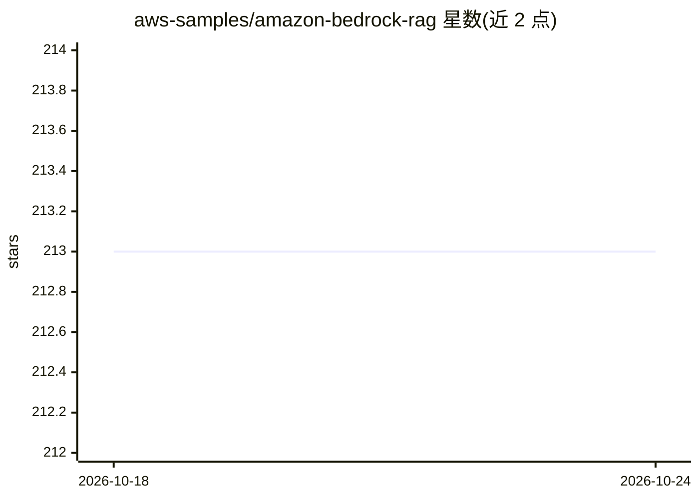

# aws-samples/amazon-bedrock-rag

⭐ 213 · JavaScript · MIT-0 · 推送 2026-07-27 · [GitHub](https://github.com/aws-samples/amazon-bedrock-rag) · 组织维护

**基于 Knowledge Bases for Amazon Bedrock 的全托管 RAG 部署方案**

AWS 官方 samples 项目：用 AWS CDK 部署一套全托管 RAG 后端（API Gateway、Lambda、S3、OpenSearch Serverless、WAF），基于 Knowledge Bases for Amazon Bedrock 实现从数据摄取、向量化到检索与回答生成的完整流程。数据源支持 S3 文档与网站爬取，默认生成模型为 Anthropic Claude，嵌入用 Amazon Titan Embeddings。同时支持免外部向量库的 Managed Knowledge Bases 与 agentic retrieval。面向在 AWS 上构建企业问答/知识库应用的开发者，需自行承担云资源费用（OpenSearch Serverless 至少 4 OCU）。

## 筛选速览

| 维度 | 判定 | 备注 |
|---|---|---|
| AI 角色 | `ai-ecosystem` | LLM/agent 周边工具 |
| 许可风险 | `permissive` | MIT-0 |
| 部署形态 | `library` | 以包/库形式分发 |
| 模型依赖 | locked-api |  |
| 硬件要求 | — | 无带数字的原话,不猜 |
| 安装摩擦 | `low` | 无编译、无系统依赖或容器化 |
| 成熟度 | — | 结构信号不足 |

## 能力要点

- CDK 一键部署后端（API Gateway/Lambda/S3/OpenSearch Serverless/WAF）
- 双数据源：S3 文档自动触发摄取 + 网站爬虫数据源
- 支持 Managed Knowledge Bases（免外部向量库、agentic retrieval、可配置重排序）
- 前端 Web 界面可选模型并展示带引用的回答

## 适用场景

- 在 AWS 上快速搭建企业内部知识库问答系统
- 以 S3 文档和网站内容作为数据源做检索增强问答
- 对比托管知识库与自管向量库两种部署形态

## 场景标签

`RAG` · 领域:知识与检索

## 证据(README 行号)

> L1: # Implement a fully managed RAG solution using Knowledge Bases for Amazon Bedrock
> L7: Knowledge Bases for Amazon Bedrock is a fully managed capability that helps you implement the entire RAG workflow fr
> L36: cdk deploy --context allowedip="xxx.xxx.xxx.xxx/32"

## 星数曲线

2026-10-18 213 → 2026-10-24 213（+0）

---
*卡片 v1 · prompt 1.4 · 生成 2026-10-22 · 置信度 high · 依据 README sha `bbe03e7a23d9` · [字段定义](../../DATASET.md)*
