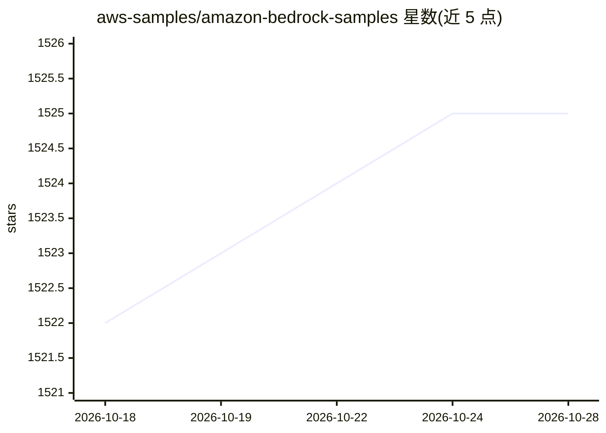

# aws-samples/amazon-bedrock-samples

⭐ 1,525 · Jupyter Notebook · MIT-0 · 推送 2026-10-22 · [GitHub](https://github.com/aws-samples/amazon-bedrock-samples) · [官网](https://aws.amazon.com/bedrock/) · 组织维护

**Amazon Bedrock 官方示例代码集：帮助用户上手基础模型**

AWS 官方维护的 Amazon Bedrock 示例仓库：提供覆盖各可用基础模型的预构建代码示例，按目录组织，每个目录自带 README 说明。使用前提是已获得 Amazon Bedrock 访问权限，README 给出 IAM 权限配置步骤与示例策略 JSON，说明 SageMaker 执行角色与控制台用户需分别授权。获取方式为克隆仓库后进入各目录运行，许可证为 MIT-0。

## 筛选速览

| 维度 | 判定 | 备注 |
|---|---|---|
| AI 角色 | `ai-knowledge` | 知识聚合/清单类 |
| 许可风险 | `permissive` | MIT-0 |
| 部署形态 | `None` |  |
| 模型依赖 | locked-api |  |
| 硬件要求 | — | 无带数字的原话,不猜 |
| 安装摩擦 | `low` | 无编译、无系统依赖或容器化 |
| 成熟度 | — | 结构信号不足 |

## 能力要点

- 覆盖 Bedrock 全部可用基础模型的预构建示例
- 各目录自带 README 提供详细运行说明
- 给出 IAM 权限配置的示例策略 JSON

## 适用场景

- 快速上手 Amazon Bedrock 各基础模型的调用
- 参考官方示例搭建 RAG、知识库与 embedding 应用
- 学习 Bedrock 所需的 IAM 权限配置方法

## 场景标签

 · 领域:云上生成式 AI 示例

## 证据(README 行号)

> L5: This repository contains pre-built examples to help customers get started with the Amazon Bedrock service.
> L11: To get started with the code examples, ensure you have access to Amazon Bedrock. Then clone this repo and navigate 

## 星数曲线

2026-10-18 1,522 → 2026-10-28 1,525（+3）

---
*卡片 v1 · prompt 1.4 · 生成 2026-10-21 · 置信度 high · 依据 README sha `e812637b967e` · [字段定义](../../DATASET.md)*
