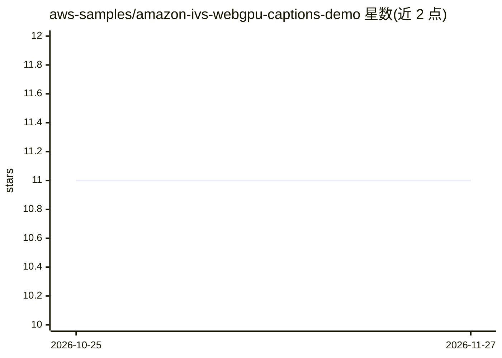

# aws-samples/amazon-ivs-webgpu-captions-demo

⭐ 11 · JavaScript · MIT-0 · 推送 2026-11-20 · [GitHub](https://github.com/aws-samples/amazon-ivs-webgpu-captions-demo) · [官网](https://ivs.rocks) · 组织维护

**在浏览器端为 Amazon IVS 直播流生成实时字幕的演示应用**

基于 Transformers.js 与 ONNX Runtime Web 的演示 Web 应用，通过 WebGPU 加速在浏览器本地对 Amazon IVS 低延迟与实时直播流做实时转录，生成字幕。需部署配套 serverless 后端（Lambda、S3、CloudFront、IVS Stage）获取 API 地址，前端用 npm 运行或部署到 CloudFront。README 声明仅用于教育目的的实验性演示，不支持生产使用，仅官方支持支持 WebGPU 的浏览器与设备。

## 筛选速览

| 维度 | 判定 | 备注 |
|---|---|---|
| AI 角色 | `ai-native` | 本体是模型或模型工具 |
| 许可风险 | `permissive` | MIT-0 |
| 部署形态 | `None` |  |
| 模型依赖 | — | README 未给出锁定关系 |
| 硬件要求 | — | 无带数字的原话,不猜 |
| 安装摩擦 | `low` | 无编译、无系统依赖或容器化 |
| 成熟度 | — | 结构信号不足 |

## 能力要点

- Transformers.js + ONNX Runtime Web 实现浏览器本地转录
- WebGPU 加速的实时字幕生成
- 可通过修改 src/constants.js 的 SAMPLE_MODELS 更换模型
- 提供 npm 脚本一键部署后端与前端

## 适用场景

- 给 Amazon IVS 低延迟直播加浏览器端自动字幕
- 演示 WebGPU 在浏览器内运行语音识别模型
- 体验无需服务端推理的客户端转录方案

## 场景标签

`语音识别` · 领域:感知与多模态

## 证据(README 行号)

> L3: A demo web application that showcases state-of-the-art client-side transcription, with everything running directly i
> L4: ](https://github.com/xenova/transformers.js) and ONNX Runtime Web, this demo enables WebGPU-accelerated real-time in

## 星数曲线

2026-10-25 11 → 2026-11-27 11（+0）

---
*卡片 v1 · prompt 1.4 · 生成 2026-11-18 · 置信度 high · 依据 README sha `49ec3a7e7200` · [字段定义](../../DATASET.md)*
