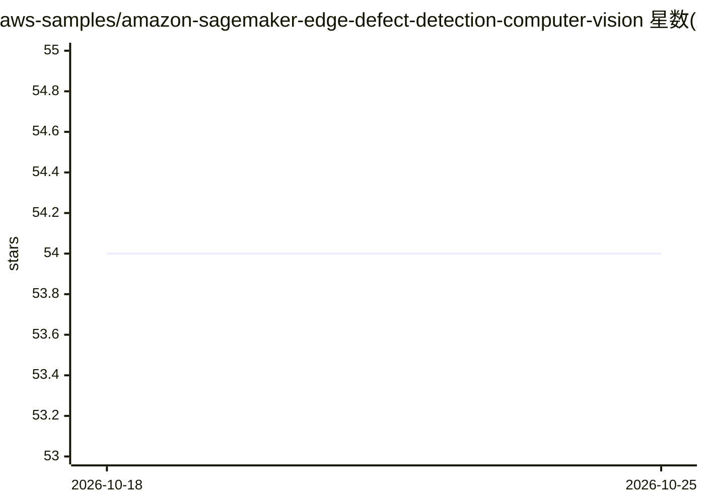

# aws-samples/amazon-sagemaker-edge-defect-detection-computer-vision

⭐ 54 · Python · MIT-0 · 推送 2026-10-23 · [GitHub](https://github.com/aws-samples/amazon-sagemaker-edge-defect-detection-computer-vision) · 组织维护

**AWS 工作坊：用 SageMaker 构建工业缺陷检测模型并部署到边缘**

配套 AWS 机器学习博客的工作坊代码：通过 SageMaker Pipelines 在云端训练图像分类（内置 MXNet 算法）与语义分割（TensorFlow/Keras UNET）两类缺陷检测模型，经 SageMaker Neo 编译与 Edge Manager 打包后，经 AWS IoT OTA 更新部署到边缘设备，由 Edge Agent 提供低延迟 gRPC 推理，配套 Flask Web 应用展示结果。示例使用 KolektorSDD2 表面缺陷数据集（3000+ 图像及掩码）。README 明确声明该样例已过时：SageMaker Edge Manager 已于 2024 年 4 月 26 日停用。

## 筛选速览

| 维度 | 判定 | 备注 |
|---|---|---|
| AI 角色 | `ai-native` | 本体是模型或模型工具 |
| 许可风险 | `permissive` | MIT-0 |
| 部署形态 | `library` | 以包/库形式分发 |
| 模型依赖 | — | README 未给出锁定关系 |
| 硬件要求 | — | 无带数字的原话,不猜 |
| 安装摩擦 | `medium` | 含编译或系统依赖之一 |
| 成熟度 | — | 结构信号不足 |

## 能力要点

- 云端训练→Neo 编译→IoT OTA 下发→边缘推理的完整 MLOps 流程
- 图像分类与 UNET 语义分割两种模型，支持带标签与掩码的自有数据集
- 边缘侧 Edge Agent 通过 gRPC API 提供低延迟预测
- CloudFormation 一键创建 IoT 设备、边缘车队与配置包

## 适用场景

- 学习如何在工业质检场景做云端训练与边缘部署
- 参考 EC2 模拟边缘设备（或树莓派/Jetson）的部署流程
- 复用缺陷检测训练 pipeline 处理自己的标注数据集

## 场景标签

`目标检测` `MLOps` `教程课程` · 领域:学习与行业

## 证据(README 行号)

> L5: In this workshop, we will walk you through a step by step process to build and train computer vision models with Ama
> L16: 3. **Edge inference**: The edge device is running the actual application for defect detection. In this workshop, we
> L34: * an image classification model using the built-in SageMaker Image Classification algorithm based on the MXNet fram

## 星数曲线

2026-10-18 54 → 2026-10-25 54（+0）

---
*卡片 v1 · prompt 1.4 · 生成 2026-10-24 · 置信度 high · 依据 README sha `92ee78751c60` · [字段定义](../../DATASET.md)*
