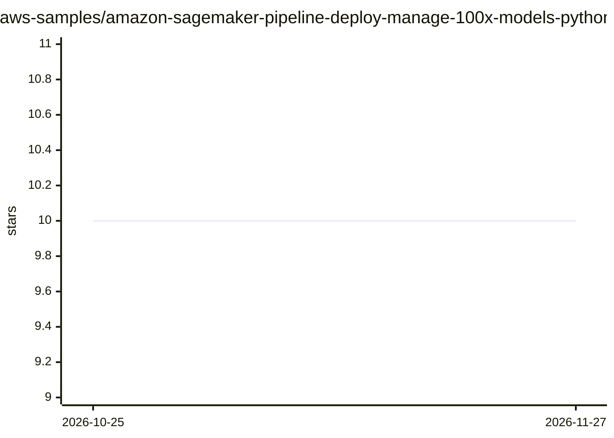

# aws-samples/amazon-sagemaker-pipeline-deploy-manage-100x-models-python-cdk

⭐ 10 · Python · MIT-0 · 推送 2026-07-28 · [GitHub](https://github.com/aws-samples/amazon-sagemaker-pipeline-deploy-manage-100x-models-python-cdk) · 组织维护

**面向 ML 团队的 SageMaker 100x 模型 MLOps 流水线示例**

aws-samples 提供的示例代码仓库：用 Amazon SageMaker Pipelines 与 AWS CDK 定义四个 stack，构建覆盖数据预处理、训练/再训练、超参调优、数据与模型质量检查、模型注册与部署的端到端 MLOps 流水线，通过 CI/CD 自动化部署与管理 100 个按数据维度划分的 XGBoost 模型。推理侧由 S3 上传触发 Lambda 与 SQS，调用 SageMaker endpoint 后将预测结果写入 DynamoDB。示例数据集为合成的电信客户流失数据。

## 筛选速览

| 维度 | 判定 | 备注 |
|---|---|---|
| AI 角色 | `ai-ecosystem` | LLM/agent 周边工具 |
| 许可风险 | `permissive` | MIT-0 |
| 部署形态 | `library` | 以包/库形式分发 |
| 模型依赖 | — | README 未给出锁定关系 |
| 硬件要求 | — | 无带数字的原话,不猜 |
| 安装摩擦 | `low` | 无编译、无系统依赖或容器化 |
| 成熟度 | — | 结构信号不足 |

## 能力要点

- 用 CDK 定义 4 个 stack 完成整套基础设施编排
- 新训练数据上传 S3 即自动触发再训练流水线
- 模型注册后由 LambdaStep 自动部署新版本并下线旧版本
- 推理链路：S3→Lambda→SQS→SageMaker endpoint→DynamoDB

## 适用场景

- 为多模型批量部署搭建可复用的 SageMaker MLOps 流水线
- 训练数据更新后自动触发模型再训练与上线
- 搭建实时推理并将结果落库到 DynamoDB 的架构参考

## 场景标签

`MLOps` · 领域:训练与推理

## 证据(README 行号)

> L5: This GitHub repository showcases the implementation of a comprehensive end-to-end MLOps pipeline using Amazon SageMa
> L12: 2. **SM Pipeline Stack**: Creates a code build pipeline responsible for creating and updating the SageMaker pipelin

## 星数曲线

2026-10-25 10 → 2026-11-27 10（+0）

---
*卡片 v1 · prompt 1.4 · 生成 2026-11-19 · 置信度 high · 依据 README sha `7292d9d60851` · [字段定义](../../DATASET.md)*
