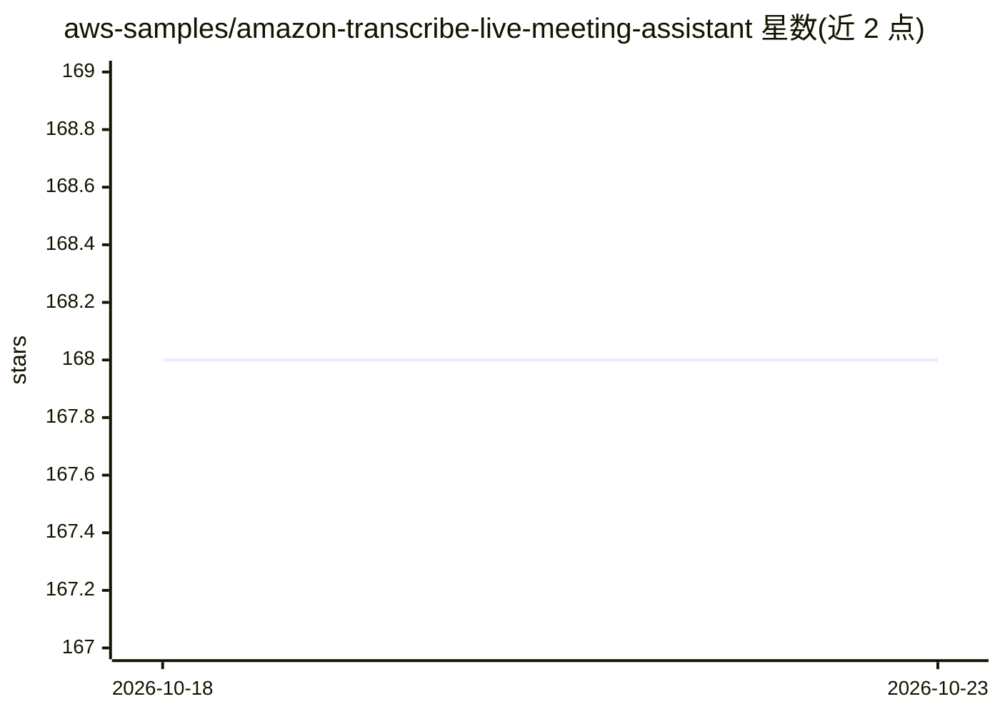

# aws-samples/amazon-transcribe-live-meeting-assistant

⭐ 168 · Python · MIT · 推送 2026-10-22 · [GitHub](https://github.com/aws-samples/amazon-transcribe-live-meeting-assistant) · [官网](https://aws-samples.github.io/amazon-transcribe-live-meeting-assistant/) · 组织维护

**实时会议转录/翻译/摘要与 AI 助手的 AWS 解决方案**

基于 Amazon Transcribe、Amazon Bedrock 与 Strands Agents SDK 构建的实时会议助手：提供带说话人归属的直播转录、75+ 语言翻译、按需与自动会议摘要、带内置工具的 AI 会议助手，以及 MCP server 扩展。音频采集支持无头 Chrome 虚拟参会者（Zoom/Teams/Chime/WebEx）与 macOS/Windows 桌面捕获应用；转录结果经 Kinesis/Lambda 处理后存 DynamoDB 并通过 AppSync 推送 React 界面。以 AWS CloudFormation 一键部署方式提供，面向使用 AWS 的企业用户，含月度成本估算；要求使用者遵守会议录制相关法律与公司规定。

## 筛选速览

| 维度 | 判定 | 备注 |
|---|---|---|
| AI 角色 | `ai-native` | 本体是模型或模型工具 |
| 许可风险 | `permissive` | MIT |
| 部署形态 | `None` |  |
| 模型依赖 | locked-api |  |
| 硬件要求 | — | 无带数字的原话,不猜 |
| 安装摩擦 | `low` | 无编译、无系统依赖或容器化 |
| 成熟度 | — | 结构信号不足 |

## 能力要点

- 带说话人归属的实时转录（Amazon Transcribe）与 75+ 语言实时翻译
- 基于 Strands Agents SDK + Amazon Bedrock 的 AI 会议助手，支持 MCP server 扩展外部工具
- 虚拟参会者（无头 Chrome bot）可加入 Zoom/Teams/Chime/WebEx，另有 macOS/Windows 桌面捕获应用
- 按需/自动会议摘要、行动项生成，以及基于 Bedrock Knowledge Base 的历史会议语义检索

## 适用场景

- 会议中实时获得转录与翻译，无需手动记笔记
- 会后自动生成摘要与行动项发给未参会成员
- 通过对话让 AI 助手检索会议记录、网页和文档以即时答疑
- 跨历史会议语义检索过往讨论内容

## 场景标签

`语音识别` `AI 助手` `语义搜索` · 领域:对话与助手

## 证据(README 行号)

> L21: - **Live transcription with speaker attribution** — Powered by Amazon Transcribe with custom vocabulary and languag
> L23: - **AI meeting assistant** — Strands Agents SDK with Amazon Bedrock, with built-in tools for transcript search, web
> L25: - **On-demand and automatic summaries** — Generate summaries, action items, and insights during and after meetings

## 星数曲线

2026-10-18 168 → 2026-10-23 168（+0）

---
*卡片 v1 · prompt 1.4 · 生成 2026-10-22 · 置信度 high · 依据 README sha `c5b7052dad18` · [字段定义](../../DATASET.md)*
