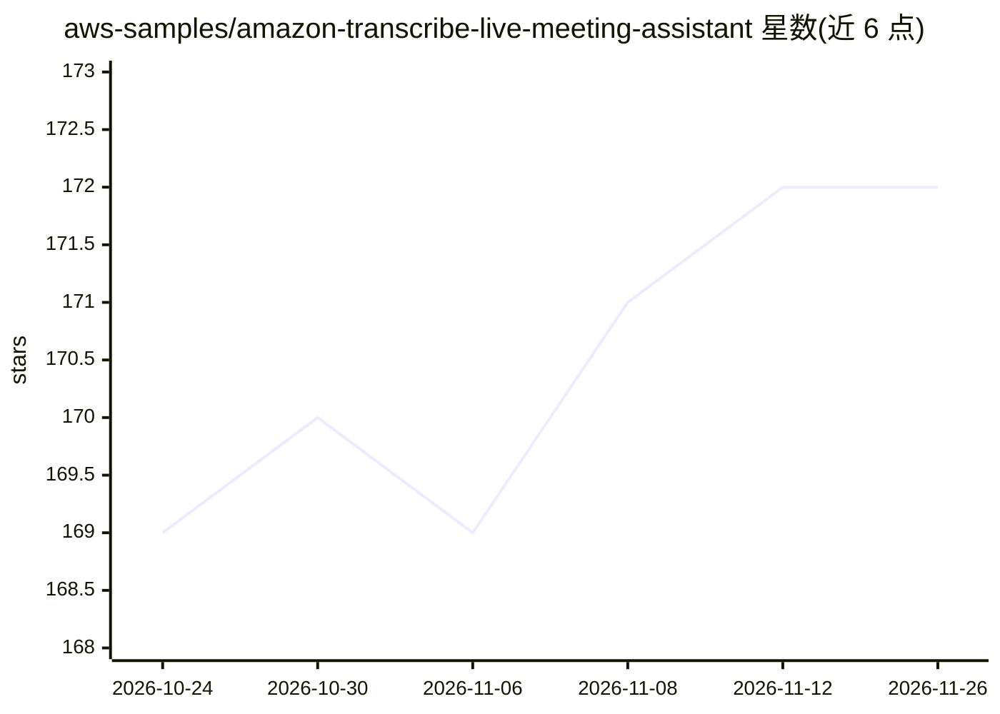

# aws-samples/amazon-transcribe-live-meeting-assistant

⭐ 172 · Python · MIT-0 · 推送 2026-11-25 · [GitHub](https://github.com/aws-samples/amazon-transcribe-live-meeting-assistant) · [官网](https://aws-samples.github.io/amazon-transcribe-live-meeting-assistant/) · 组织维护

**加入会议的 AI 助手：实时转录、翻译、问答与纪要**

部署在用户自有 AWS 账户的会议助手方案：Virtual Participant 以客人身份加入 Zoom、Teams、Google Meet、Webex、Chime 会议，实时生成带说话人标注的转录并翻译 75+ 种语言，可在会议聊天中回答提问，会后输出摘要、行动项、议程覆盖情况与可检索的幻灯片截图。语音引擎默认用 Amazon Transcribe，也可选自托管 ASR MicroVM；助手基于 Bedrock 模型与 Strands Agents SDK 构建，支持 MCP 双向集成。含会议同意记录与保留策略功能。

## 筛选速览

| 维度 | 判定 | 备注 |
|---|---|---|
| AI 角色 | `ai-native` | 本体是模型或模型工具 |
| 许可风险 | `permissive` | MIT-0 |
| 部署形态 | `None` |  |
| 模型依赖 | locked-api |  |
| 硬件要求 | — | 无带数字的原话,不猜 |
| 安装摩擦 | `low` | 无编译、无系统依赖或容器化 |
| 成熟度 | — | 结构信号不足 |

## 能力要点

- Virtual Participant 以客人身份加入多平台会议并实时转录、翻译 75+ 种语言
- 共享房间内区分并标注每位说话人，支持声纹注册（Beta）
- 带工具的会议 Agent：搜索本次/历史会议、文档与网页，可在会议聊天中提问
- 会议同意记录、保留策略与逐会议成本估算

## 适用场景

- 远程会议实时转录、翻译并区分说话人
- 会议进行中向 AI 提问并自动生成纪要和行动项
- 需要留存参会者同意记录的合规录音场景

## 场景标签

`AI 助手` `语音识别` · 领域:对话与助手

## 证据(README 行号)

> L3: **An AI teammate in your meetings, not just a note taker.** LMA joins your Zoom, Microsoft Teams, Google Meet, Webex
> L63: Audio streams over a secure WebSocket to the transcriber service on AWS Fargate. That service sends it to the meeti

## 星数曲线

2026-10-24 169 → 2026-11-26 172（+3）

---
*卡片 v1 · prompt 1.4 · 生成 2026-11-26 · 置信度 high · 依据 README sha `32eeecee9763` · [字段定义](../../DATASET.md)*
