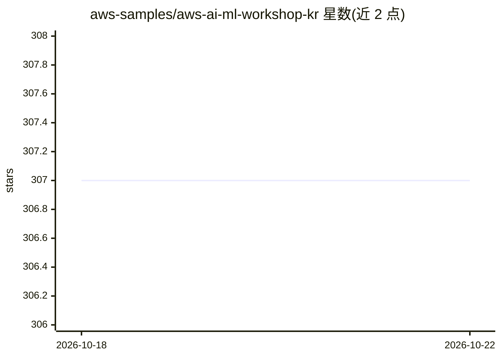

# aws-samples/aws-ai-ml-workshop-kr

⭐ 307 · Jupyter Notebook · MIT-0 · 推送 2026-08-04 · [GitHub](https://github.com/aws-samples/aws-ai-ml-workshop-kr) · 组织维护

**AWS 韩语 AI/ML 实操工作坊示例集合**

AWS 官方 samples 组织维护的韩文本地化 AI/ML 工作坊材料仓库，按三大类别组织：Generative AI（应用、推理部署、微调训练）、SageMaker AI（入门训练与 HyperPod 模型训练）、AWS Neuron（Inferentia/Inferentia2/Trainium 相关示例）。面向参加 AWS 上机实操的开发者与学习者，各目录附有独立 README 说明。仓库以 Apache 2.0 许可发布，提供贡献指南。

## 筛选速览

| 维度 | 判定 | 备注 |
|---|---|---|
| AI 角色 | `ai-knowledge` | 知识聚合/清单类 |
| 许可风险 | `permissive` | MIT-0 |
| 部署形态 | `None` |  |
| 模型依赖 | — | README 未给出锁定关系 |
| 硬件要求 | — | 无带数字的原话,不猜 |
| 安装摩擦 | `low` | 无编译、无系统依赖或容器化 |
| 成熟度 | — | 结构信号不足 |

## 能力要点

- Generative AI 覆盖应用、模型部署（推理）与微调（训练）三类示例
- SageMaker AI 含入门训练（101）与 HyperPod 模型训练示例
- AWS Neuron（Inferentia/Inferentia2/Trainium）相关示例

## 适用场景

- 跟随韩语材料上手 AWS 生成式 AI 应用与部署
- 学习 SageMaker 端到端 ML 训练与 HyperPod 用法
- 查阅 AWS 自研加速芯片（Neuron）的使用示例

## 场景标签

`教程课程` `微调` `模型训练` `推理引擎` · 领域:学习与行业

## 证据(README 行号)

> L12: AWS AIML 코드 및 워크샵 예제가 있습니다.
> L15: - Generative AI : Generative AI와 관련된 예제 및 관련 서비스 응용사례

## 星数曲线

2026-10-18 307 → 2026-10-22 307（+0）

---
*卡片 v1 · prompt 1.4 · 生成 2026-10-21 · 置信度 high · 依据 README sha `c70fab107df0` · [字段定义](../../DATASET.md)*
