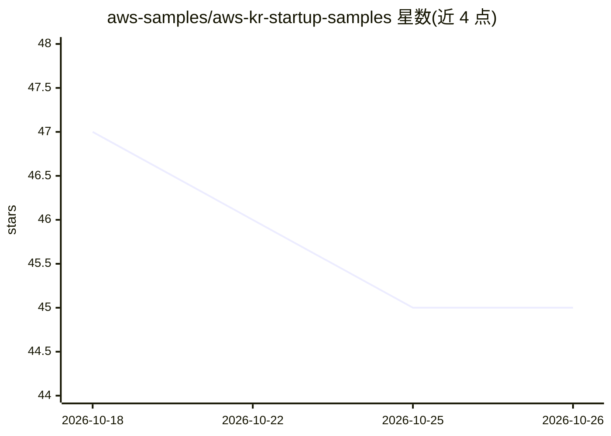

# aws-samples/aws-kr-startup-samples

⭐ 45 · Jupyter Notebook · MIT-0 · 推送 2026-04-02 · [GitHub](https://github.com/aws-samples/aws-kr-startup-samples) · [官网](https://www.awsstartup.io) · 组织维护

**AWS 韩国 Startup SA 团队实操样例与工作坊资料合集**

由 AWS 韩国 Startup 解决方案架构师团队维护的 monorepo，收录面向初创企业的实操样例代码与工作坊资料，主题涵盖生成式 AI、RAG、分析、容器、DevOps、SaaS 与安全等。仓库建议通过 git sparse-checkout 选择性拉取特定项目目录（如 rag-with-amazon-bedrock-and-opensearch），而非整体下载。内容为韩文与英文混排，MIT-0 许可。

## 筛选速览

| 维度 | 判定 | 备注 |
|---|---|---|
| AI 角色 | `ai-knowledge` | 知识聚合/清单类 |
| 许可风险 | `permissive` | MIT-0 |
| 部署形态 | `None` |  |
| 模型依赖 | — | README 未给出锁定关系 |
| 硬件要求 | — | 无带数字的原话,不猜 |
| 安装摩擦 | `low` | 无编译、无系统依赖或容器化 |
| 成熟度 | — | 结构信号不足 |

## 能力要点

- 涵盖 gen-ai/RAG、分析、容器、DevOps、安全等多主题样例
- monorepo 结构，提供 git sparse-checkout 选择性拉取流程
- 由 AWS 韩国 Startup SA 团队维护并配套 AWS Bootcamp 资源

## 适用场景

- 查找 AWS 上的 RAG 与生成式 AI 实操样例代码
- 初创团队按主题选择性获取对应工作坊工程
- 了解 AWS Startup 相关服务与实战案例

## 场景标签

`教程课程` · 领域:学习与行业

## 证据(README 行号)

> L3: Welcome. This reference has been prepared by Startup Solution Architects at AWS Korea to help Startups easily find a
> L9: This repository is massive, containing numerous files, which qualifies it as a `monorepo`.

## 星数曲线

2026-10-18 47 → 2026-10-26 45（-2）

---
*卡片 v1 · prompt 1.4 · 生成 2026-10-25 · 置信度 high · 依据 README sha `595c3cd0e101` · [字段定义](../../DATASET.md)*
