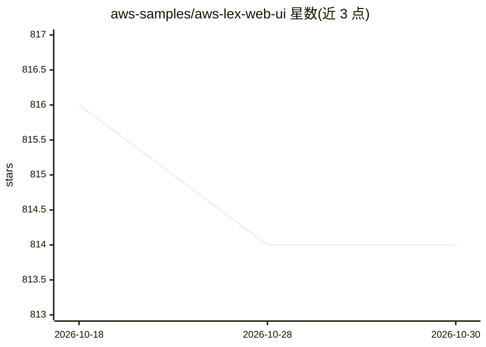

# aws-samples/aws-lex-web-ui

⭐ 814 · JavaScript · NOASSERTION · 推送 2026-10-22 · [GitHub](https://github.com/aws-samples/aws-lex-web-ui) · 组织维护

**给网站开发者的 Amazon Lex 聊天机器人 Web 界面组件**

Amazon Lex 的示例聊天界面：提供可直接集成到网站的聊天 UI 组件与加载器 JavaScript 库，支持全页或 iframe 嵌入两种形态，支持文本与语音交互（静音检测、转录、打断与重播）、展示 Lex 响应卡片、Connect 交互消息模板，并可通过 JavaScript 编程配置。部署方式包括 CloudFormation 一键部署（自动创建示例 Lex bot 与 Cognito Identity Pool、托管到 S3）或直接引用 dist 目录的预构建库。限制：新区域仅支持 Lex V2，需先部署 V2 bot。

## 筛选速览

| 维度 | 判定 | 备注 |
|---|---|---|
| AI 角色 | `ai-ecosystem` | LLM/agent 周边工具 |
| 许可风险 | `none` | NOASSERTION |
| 部署形态 | `library` | 以包/库形式分发 |
| 模型依赖 | — | README 未给出锁定关系 |
| 硬件要求 | — | 无带数字的原话,不猜 |
| 安装摩擦 | `low` | 无编译、无系统依赖或容器化 |
| 成熟度 | — | 结构信号不足 |

## 能力要点

- 全页或 iframe 嵌入的可复用 JavaScript 聊天 UI 组件与 loader 库
- 文本/语音双模式，支持静音检测、转录、打断与录音重播
- CloudFormation 一键部署，自动创建示例 Lex bot 与 Cognito Identity Pool
- 支持 Lex 响应卡片与 Connect ListPicker/TimePicker 模板

## 适用场景

- 在我的网站上嵌入一个连接 Amazon Lex 的聊天机器人
- 通过 CloudFormation 快速搭一个 Lex 聊天机器人演示站
- 用语音或文本与已有 Lex bot 交互并展示响应卡片

## 场景标签

`聊天机器人` · 领域:对话与助手

## 证据(README 行号)

> L4: This is a sample Amazon Lex
> L6: in your website. The interface allows a user to interact with a Lex bot directly
> L76: This project provides a set of JavaScript libraries used to dynamically

## 星数曲线

2026-10-18 816 → 2026-10-30 814（-2）

---
*卡片 v1 · prompt 1.4 · 生成 2026-10-21 · 置信度 mid · 依据 README sha `d011e3bc0bc5` · [字段定义](../../DATASET.md)*
