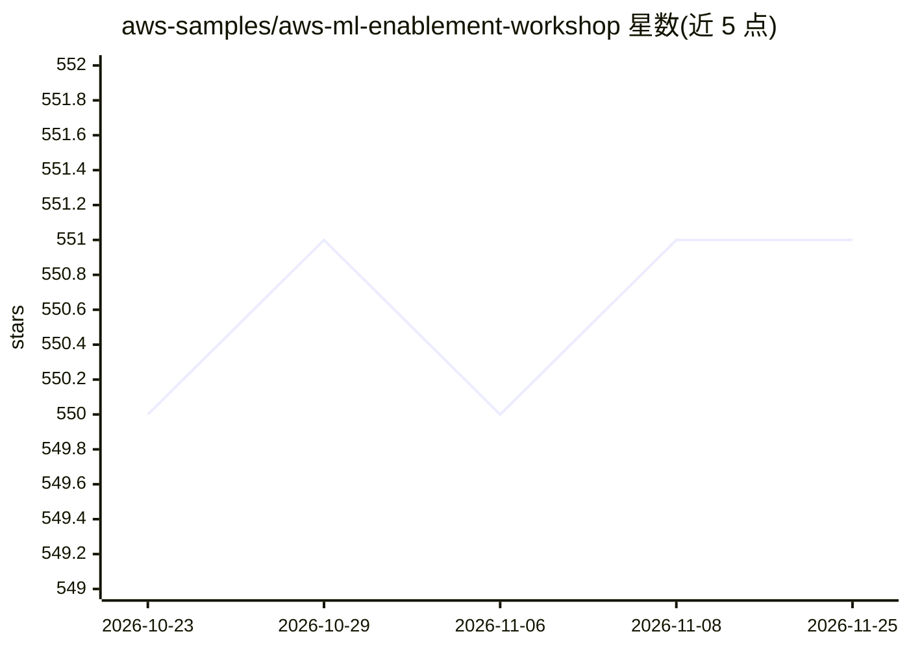

# aws-samples/aws-ml-enablement-workshop

⭐ 551 · Jupyter Notebook · MIT-0 · 推送 2026-11-18 · [GitHub](https://github.com/aws-samples/aws-ml-enablement-workshop) · 组织维护

**面向产品团队：用生成 AI 规划 ML 产品落地的工作坊资料集**

AWS 开发维护的工作坊资料仓库，目标是组建跨职能团队并制定将 AI/ML 技术转化为产品增长的计划。流程分 Day0、实践篇、改善篇三段，围绕 Working Backwards 方法用生成 AI 产出多份新闻稿与原型 mock，并在 mock 基础上规划 3-6 个月的发布计划。仓库本身不含可安装运行的产品，公开的是工作坊指南、社区版资料、客户案例、SageMaker Studio Lab 实践教程（9 步）及场景化实践内容，采用 MIT-0 许可证，禁止第三方以同名举办工作坊。

## 筛选速览

| 维度 | 判定 | 备注 |
|---|---|---|
| AI 角色 | `ai-knowledge` | 知识聚合/清单类 |
| 许可风险 | `permissive` | MIT-0 |
| 部署形态 | `None` |  |
| 模型依赖 | — | README 未给出锁定关系 |
| 硬件要求 | — | 无带数字的原话,不猜 |
| 安装摩擦 | `low` | 无编译、无系统依赖或容器化 |
| 成熟度 | — | 结构信号不足 |

## 能力要点

- Day0+实践篇+改善篇的三段式工作坊流程（合计约 7.5 小时）
- 以生成 AI（Kiro、Amazon Q Developer CLI）贯穿企划到 mock 构建的全流程
- 附 9 步 SageMaker Studio Lab 机器学习项目体验教程与场景化实践（流失率改善，2-3 小时）
- 整理 MUFG、JINS、BASE 等多家企业的实施案例

## 适用场景

- 为团队制定带生成 AI 的产品验证与发布计划时引入该工作坊流程
- 作为公司内部举办生成 AI 用例讨论工作坊的参考资料
- 用 SageMaker Studio Lab 教程让开发者体验机器学习项目全流程

## 场景标签

`教程课程` · 领域:学习与行业

## 证据(README 行号)

> L3: ML Enablement Workshop は、生成 AI を含めた AI/ML 技術をプロダクトの成長に繋げられるチームを組成するためのワークショップです。
> L131: 目次のNo.1から順に進めていくことで各開発プロセスでなにを行うのか、なぜ行うのか、どう行うのかを学ぶことができます。ハンズオンは Amazon SageMaker Studio Lab を使用し進めます。アカウントの作成方法や
> L155:  * AWS が開発し、メンテナンスしています。本資料には AWS でお客様の AI/ML を活用したノウハウが詰め込まれています。具体的な改善の過程については以下記事をご参照ください。

## 星数曲线

2026-10-23 550 → 2026-11-25 551（+1）

---
*卡片 v1 · prompt 1.4 · 生成 2026-11-25 · 置信度 high · 依据 README sha `4b4c704c70ce` · [字段定义](../../DATASET.md)*
