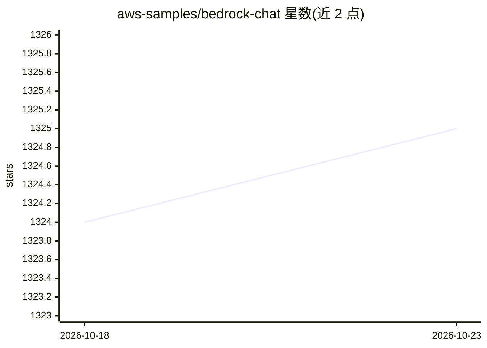

# aws-samples/bedrock-chat

⭐ 1,325 · TypeScript · MIT-0 · 推送 2026-10-21 · [GitHub](https://github.com/aws-samples/bedrock-chat) · 组织维护 · 中文 README

**基于 Amazon Bedrock 的多语言生成式 AI 对话平台**

AWS 官方 samples 出品的生成式 AI 聊天平台：基于 Amazon Bedrock 提供多语言对话、带知识库的 RAG 自定义机器人、bot store 机器人共享、以及 Agent 任务自动化。全部基于 AWS 托管服务构建（DynamoDB、API Gateway、Lambda/FastAPI、CloudFront+S3/React、Cognito、Bedrock Knowledge Bases、OpenSearch Serverless 等），通过 CloudShell 脚本或 CDK 部署，部署约 35 分钟。限制：仅支持 Bedrock 可用区域，自定义机器人创建需 Cognito 组权限，V2 升级 V3 需按迁移指南操作否则旧机器人不可用。

## 筛选速览

| 维度 | 判定 | 备注 |
|---|---|---|
| AI 角色 | `ai-native` | 本体是模型或模型工具 |
| 许可风险 | `permissive` | MIT-0 |
| 部署形态 | `library` | 以包/库形式分发 |
| 模型依赖 | locked-api |  |
| 硬件要求 | — | 无带数字的原话,不猜 |
| 安装摩擦 | `low` | 无编译、无系统依赖或容器化 |
| 成熟度 | — | 结构信号不足 |

## 能力要点

- 支持聊天、RAG 自定义机器人、bot store 共享与 Agent 任务自动化
- 全托管 AWS 架构，通过 CloudShell 一键脚本或 CDK 部署
- 支持多租户共享 Knowledge Base（突破单账户 100 个 KB 限制）
- 支持 Claude、Amazon Nova、Mistral、DeepSeek、Llama 系列模型

## 适用场景

- 在 AWS 上快速部署面向团队/企业的生成式 AI 对话平台
- 创建带私有知识（RAG）的自定义机器人并在用户间共享
- 通过 Agent 让聊天机器人调用外部工具处理复杂任务

## 场景标签

`聊天机器人` `RAG` `AI 助手` · 领域:对话与助手

## 证据(README 行号)

> L9: A multilingual generative AI platform powered by Amazon Bedrock.
> L10: Supports chat, custom bots with knowledge (RAG), bot sharing via a bot store, and task automation using agents.
> L150: It's an architecture built on AWS managed services, eliminating the need for infrastructure management. Utilizing 

## 星数曲线

2026-10-18 1,324 → 2026-10-23 1,325（+1）

---
*卡片 v1 · prompt 1.4 · 生成 2026-10-21 · 置信度 mid · 依据 README sha `98e610525f10` · [字段定义](../../DATASET.md)*
