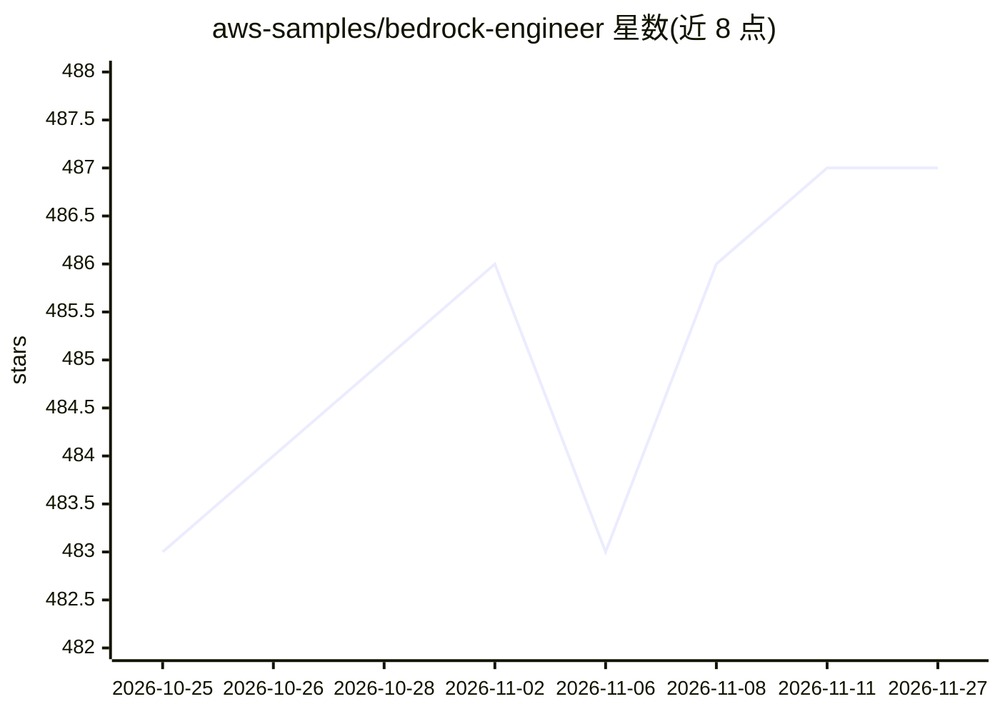

# aws-samples/bedrock-engineer

⭐ 487 · TypeScript · MIT-0 · 推送 2026-11-16 · [GitHub](https://github.com/aws-samples/bedrock-engineer) · [官网](https://speakerdeck.com/gawa/introducing-bedrock-engineer-en) · 组织维护

**基于 Amazon Bedrock 的自主软件开发 Agent 桌面应用**

一个使用 Amazon Bedrock 的自主软件开发 Agent 应用，提供独立于编辑器（如 VS Code）的聊天界面，支持创建/编辑文件、执行系统命令、Tavily 网页搜索、知识库检索、多 Agent 与图像/视频生成。内置 Software Developer、Programming Mentor、Product Designer 等默认 Agent，可自定义系统提示词与工具集。通过 macOS PKG 安装包分发，也可用 npm 从源码构建 macOS/Windows/Linux 版本；需配置 AWS 凭证。README 顶部声明该仓库已弃用，仅作为只读存档保留。

## 筛选速览

| 维度 | 判定 | 备注 |
|---|---|---|
| AI 角色 | `ai-native` | 本体是模型或模型工具 |
| 许可风险 | `permissive` | MIT-0 |
| 部署形态 | `desktop` | 安装包/桌面程序 |
| 模型依赖 | locked-api |  |
| 硬件要求 | — | 无带数字的原话,不猜 |
| 安装摩擦 | `low` | 无编译、无系统依赖或容器化 |
| 成熟度 | — | 结构信号不足 |

## 能力要点

- 内置文件系统、命令执行、网页搜索、知识库检索等可配置工具集
- 图像生成/识别与 Nova Reel 视频生成工具
- 按 Agent 独立配置系统提示词与工具
- macOS PKG 安装包分发，支持 npm 构建 macOS/Windows/Linux

## 适用场景

- 通过对话让 Agent 完成文件创建、代码生成与命令执行
- 接入 Bedrock Knowledge Base 检索知识库信息
- 用 Agent 生成图像与视频内容
- 自定义 Agent 与工具适配开发以外的场景

## 场景标签

`编码 Agent` `多智能体` `RAG` `图像生成` · 领域:Agent 开发

## 证据(README 行号)

> L18: Bedrock Engineer is Autonomous software development agent apps using Amazon Bedrock, capable of customize to create
> L118: The autonomous AI agent capable of development assists your development process. It provides functionality similar

## 星数曲线

2026-10-25 483 → 2026-11-27 487（+4）

---
*卡片 v1 · prompt 1.4 · 生成 2026-11-25 · 置信度 high · 依据 README sha `484f5e4d94d4` · [字段定义](../../DATASET.md)*
