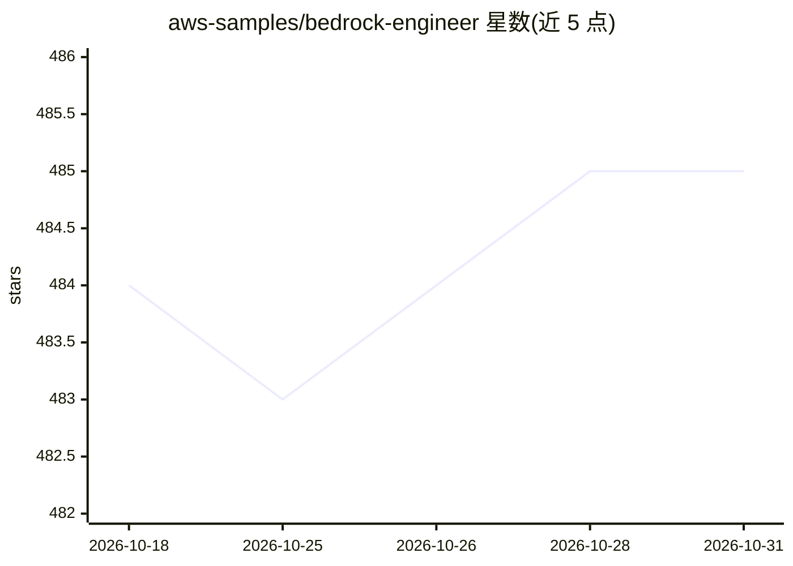

# aws-samples/bedrock-engineer

⭐ 485 · TypeScript · MIT-0 · 推送 2026-10-23 · [GitHub](https://github.com/aws-samples/bedrock-engineer) · [官网](https://speakerdeck.com/gawa/introducing-bedrock-engineer-en) · 组织维护

**基于 Amazon Bedrock 的桌面自主软件开发 Agent 应用**

AWS 官方示例仓库出品的原生桌面应用：通过 Amazon Bedrock 模型（Nova、Claude、Meta Llama 等）驱动自主 AI Agent，支持创建/编辑文件、执行受限命令、Tavily 网络搜索、Bedrock 知识库检索、图像生成/识别、Nova Reel 视频生成、多 Agent 调用（Bedrock Agents/Flows）与 MCP 客户端集成。Agent 与工具均可自定义系统提示词和工具集，内置软件开发者、编程导师、产品设计师三个预设 Agent。以 macOS PKG 安装包分发（需手动 codesign），也可用 npm 从源码构建 Windows/Linux 版本。

## 筛选速览

| 维度 | 判定 | 备注 |
|---|---|---|
| AI 角色 | `ai-native` | 本体是模型或模型工具 |
| 许可风险 | `permissive` | MIT-0 |
| 部署形态 | `desktop` | 安装包/桌面程序 |
| 模型依赖 | locked-api |  |
| 硬件要求 | — | 无带数字的原话,不猜 |
| 安装摩擦 | `low` | 无编译、无系统依赖或容器化 |
| 成熟度 | — | 结构信号不足 |

## 能力要点

- 文件系统操作、受限命令执行与 Docker 沙箱 Python 代码解释器
- 接入 Amazon Bedrock 知识库检索、图像生成/识别与 Nova Reel 视频生成
- 自定义 Agent 系统提示词与按 Agent 配置的工具集
- macOS PKG 安装包分发，支持从源码构建三平台版本

## 适用场景

- 在独立 UI 中用 AI Agent 辅助软件开发与代码分析
- 定制带知识库检索和多 Agent 协作的自定义 Agent
- 通过对话生成图像、视频并执行数据分析任务

## 场景标签

`编码 Agent` `多智能体` · 领域:Agent 开发

## 证据(README 行号)

> L7: Bedrock Engineer is Autonomous software development agent apps using Amazon Bedrock, capable of customize to create/
> L107: The autonomous AI agent capable of development assists your development process. It provides functionality similar

## 星数曲线

2026-10-18 484 → 2026-10-31 485（+1）

---
*卡片 v1 · prompt 1.4 · 生成 2026-10-21 · 置信度 high · 依据 README sha `79d07a46fc5c` · [字段定义](../../DATASET.md)*
