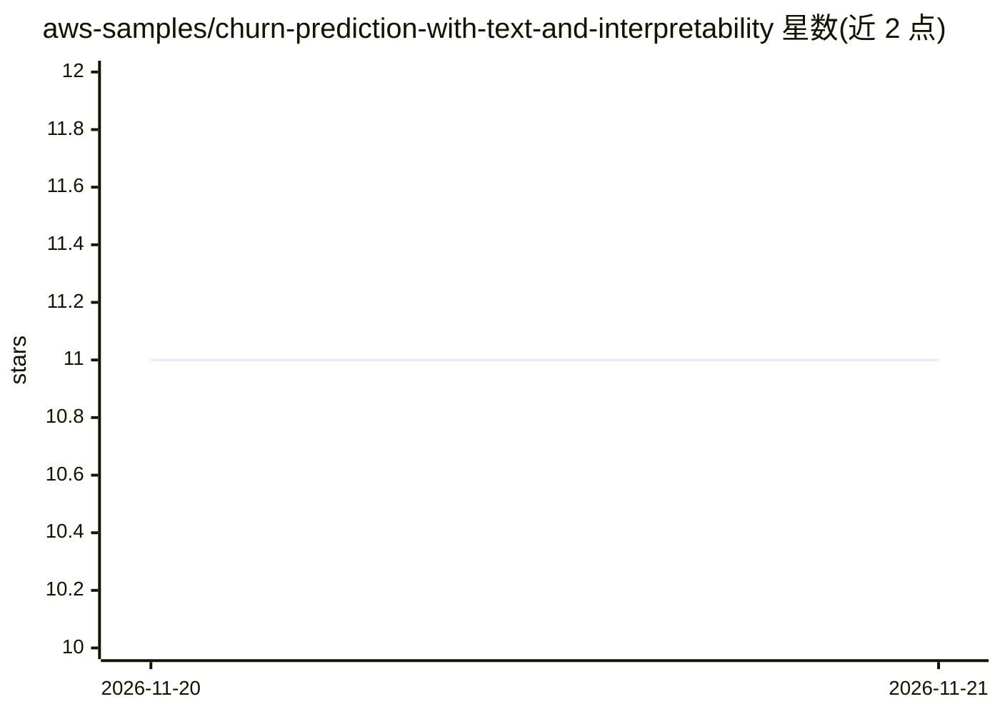

# aws-samples/churn-prediction-with-text-and-interpretability

⭐ 11 · Jupyter Notebook · MIT-0 · 推送 2026-10-06 · [GitHub](https://github.com/aws-samples/churn-prediction-with-text-and-interpretability) · 组织维护

**用文本+结构化数据预测客户流失并做可解释性分析**

AWS 提供的示例工程：基于 Kaggle Customer Churn Prediction 2020 数据集与 GPT-2 生成的合成客服文本，构建同时利用文本与数值/类别特征的双模态流失预测模型，通过 Amazon SageMaker 完成数据准备、构建与训练，并输出文本与非文本输入的特征重要性分析以定位流失根因。提供 Notebook 与终端两条运行路径（预处理/训练/解释三个脚本），依赖 Spacy、PyTorch、XGBoost、Sentence Transformers，采用 MIT-0 许可。

## 筛选速览

| 维度 | 判定 | 备注 |
|---|---|---|
| AI 角色 | `ai-knowledge` | 知识聚合/清单类 |
| 许可风险 | `permissive` | MIT-0 |
| 部署形态 | `library` | 以包/库形式分发 |
| 模型依赖 | — | README 未给出锁定关系 |
| 硬件要求 | — | 无带数字的原话,不猜 |
| 安装摩擦 | `low` | 无编译、无系统依赖或容器化 |
| 成熟度 | — | 结构信号不足 |

## 能力要点

- 文本与结构化数据结合的双模态流失预测模型架构
- 基于特征重要性的可解释性分析（文本与非文本输入）
- 提供 Notebook 与终端脚本两种运行方式
- 含合成文本数据生成脚本 create_dataset.py

## 适用场景

- 在客户流失发生前识别高流失风险客户
- 分析客户支持对话文本中的流失线索
- 定位导致客户流失的驱动因素

## 场景标签

 · 领域:机器学习/客户分析

## 证据(README 行号)

> L3: Customer churn, the loss of current customers, is a problem faced by a wide range of companies. When trying to retai
> L5: Here, we demonstrate how to build a churn prediction model that leverages both text and structured data (numerical a

## 星数曲线

2026-11-20 11 → 2026-11-21 11（+0）

---
*卡片 v1 · prompt 1.4 · 生成 2026-11-20 · 置信度 mid · 依据 README sha `f4024dca3b73` · [字段定义](../../DATASET.md)*
