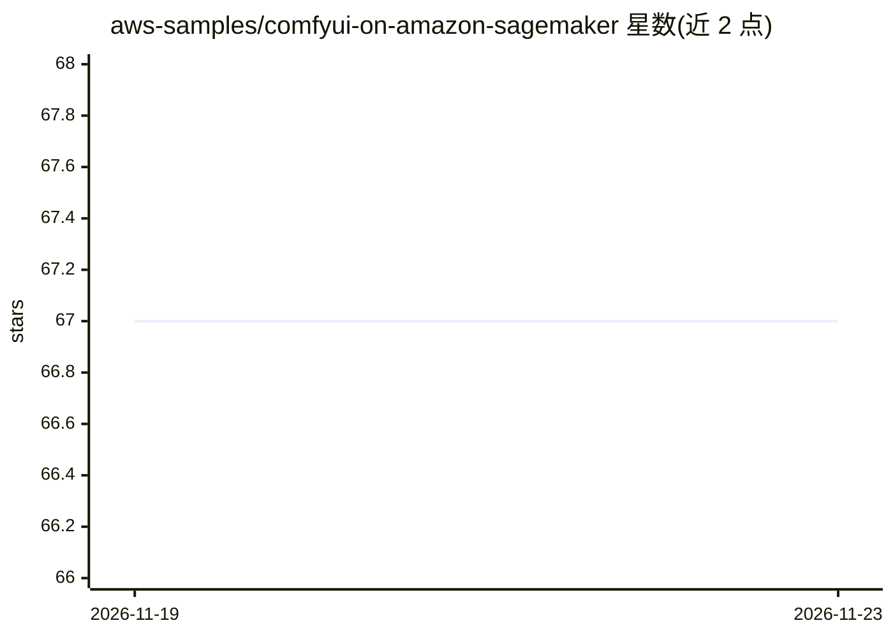

# aws-samples/comfyui-on-amazon-sagemaker

⭐ 67 · Jupyter Notebook · MIT-0 · 推送 2026-11-18 · [GitHub](https://github.com/aws-samples/comfyui-on-amazon-sagemaker) · 组织维护

**在 Amazon SageMaker 上托管 ComfyUI 生成图像的部署模式**

AWS 官方示例项目，演示通过 SageMaker 推理端点托管 ComfyUI，用 Stable Diffusion（SD1.x–SD3、SDXL）与 FLUX.1 模型生成图像。架构为 Lambda 函数调用 SageMaker 端点，并提供 Lambda Function URL 用于 HTTPS 测试，默认启用 AWS SigV4 认证。部署流程：clone 仓库后可选修改 deploy.sh、模型构建脚本与 workflow 配置，运行 deploy.sh 通过 CloudFormation 完成部署，需在 x86_64 环境构建容器（不支持 Apple Silicon 交叉架构构建）。MIT-0 许可。

## 筛选速览

| 维度 | 判定 | 备注 |
|---|---|---|
| AI 角色 | `ai-native` | 本体是模型或模型工具 |
| 许可风险 | `permissive` | MIT-0 |
| 部署形态 | `None` |  |
| 模型依赖 | — | README 未给出锁定关系 |
| 硬件要求 | — | 无带数字的原话,不猜 |
| 安装摩擦 | `medium` | 含编译或系统依赖之一 |
| 成熟度 | — | 结构信号不足 |

## 能力要点

- 一键 deploy.sh 部署 ComfyUI 到 SageMaker 推理端点
- 支持 SD1.x/SD2.x/SDXL/SD3 与 FLUX.1 模型，可加载 ckpt/safetensors/diffusers 格式
- Lambda Function URL 提供 HTTPS 测试入口，默认 SigV4 认证
- 利用 SageMaker 自动缩排在无用量时关闭实例以降低成本

## 适用场景

- 在自有 AWS 账户内自托管文生图模型并集成到应用
- 团队需要通过 API 调用 ComfyUI 工作流生成图像
- 希望使用托管服务免去实例运维与版本兼容管理

## 场景标签

`图像生成` · 领域:内容生成

## 证据(README 行号)

> L2: This project demonstrates how to generate images using Stable Diffusion by hosting ComfyUI on Amazon SageMaker Infer
> L19: There is a Lambda function to invoke SageMaker inference endpoint (which is running ComfyUI) for generating images.
> L46: git clone https://github.com/aws-samples/comfyui-on-amazon-sagemaker.git

## 星数曲线

2026-11-19 67 → 2026-11-23 67（+0）

---
*卡片 v1 · prompt 1.4 · 生成 2026-11-19 · 置信度 high · 依据 README sha `fdd48cb656eb` · [字段定义](../../DATASET.md)*
