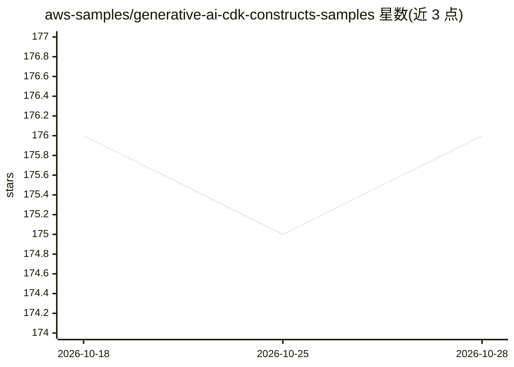

# aws-samples/generative-ai-cdk-constructs-samples

⭐ 176 · Apache-2.0 · 推送 2026-05-11 · [GitHub](https://github.com/aws-samples/generative-ai-cdk-constructs-samples) · [官网](https://github.com/awslabs/generative-ai-cdk-constructs) · 组织维护

**基于 AWS GenAI CDK Constructs 的生成式 AI 示例应用合集**

aws-samples 组织维护的示例仓库，演示如何用 AWS Generative AI CDK Constructs 构建生成式 AI 方案。包含约 20 个可部署示例：SageMaker 端点托管 Llama 2/Mistral/Zephyr 等模型、Bedrock Agents 与 Knowledge Base、多模态 RAG、合同合规分析、RFP 自动应答、多种 MCP Server 部署形态（Lambda/ECS、有状态/无状态）及 Nova Sonic 语音到语音方案。语言覆盖 TypeScript、Python、.NET，均为 AWS 云上 CDK 部署。

## 筛选速览

| 维度 | 判定 | 备注 |
|---|---|---|
| AI 角色 | `ai-knowledge` | 知识聚合/清单类 |
| 许可风险 | `permissive` | Apache-2.0 |
| 部署形态 | `library` | 以包/库形式分发 |
| 模型依赖 | locked-api |  |
| 硬件要求 | — | 无带数字的原话,不猜 |
| 安装摩擦 | `low` | 无编译、无系统依赖或容器化 |
| 成熟度 | — | 结构信号不足 |

## 能力要点

- SageMaker 实时/异步端点托管 Llama 2、Mistral 7B、Stable Video Diffusion 等模型
- Amazon Bedrock Agents / Knowledge Bases 的 RAG 与 Agent 示例
- Lambda 与 ECS 上的有状态/无状态 MCP Server 部署示例
- TypeScript / Python / .NET 三种语言的 CDK 用法示例

## 适用场景

- 参考现成 CDK 栈在 AWS 上部署 LLM 推理端点
- 搭建基于 Bedrock Knowledge Bases 的 RAG 聊天机器人
- 在 AWS 上部署 MCP Server 并接入测试客户端

## 场景标签

`Agent 框架` `聊天机器人` `RAG` `推理引擎` · 领域:Agent 开发

## 证据(README 行号)

> L1: # Sample Apps for AWS Generative AI CDK Constructs
> L3: This repo provides samples to demonstrate how to build your own Generative AI solutions using AWS Generative AI CDK 

## 星数曲线

2026-10-18 176 → 2026-10-28 176（+0）

---
*卡片 v1 · prompt 1.4 · 生成 2026-10-22 · 置信度 mid · 依据 README sha `58c05214e79d` · [字段定义](../../DATASET.md)*
