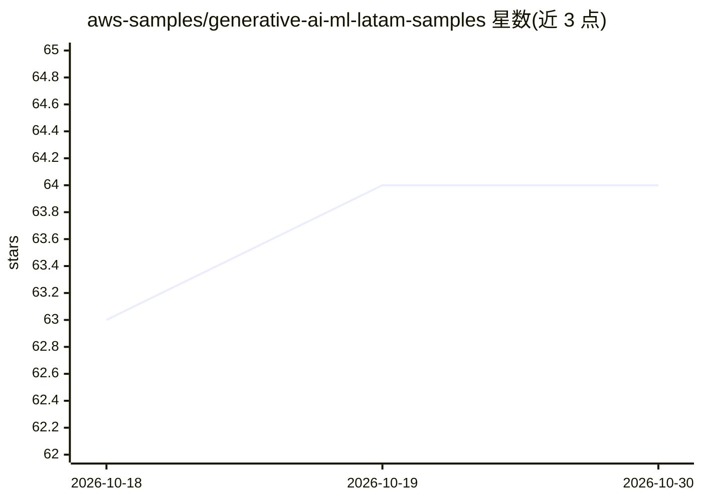

# aws-samples/generative-ai-ml-latam-samples

⭐ 64 · Python · MIT-0 · 推送 2026-10-29 · [GitHub](https://github.com/aws-samples/generative-ai-ml-latam-samples) · 组织维护

**面向拉美市场的生成式 AI 与 ML 示例/蓝图/POC 集合**

aws-samples 维护的代码样例仓库，收录三类内容：Blueprints（含 CloudFormation 模板的端到端方案，如多页文档分析、合同合规、处方识别）、Samples（演示单一 AI/ML 功能的代码/notebook，如 Bedrock 多智能体、SQL Agent、Nova 模型示例）与 Proof of Concepts（论文技术实现）。多数方案基于 Amazon Bedrock、Nova、Rekognition 等 AWS 服务构建，标注适用行业（金融、法律、零售、医疗等）与支持语言（西语/英语/多语言），面向 LATAM 市场。

## 筛选速览

| 维度 | 判定 | 备注 |
|---|---|---|
| AI 角色 | `ai-knowledge` | 知识聚合/清单类 |
| 许可风险 | `permissive` | MIT-0 |
| 部署形态 | `None` |  |
| 模型依赖 | — | README 未给出锁定关系 |
| 硬件要求 | — | 无带数字的原话,不猜 |
| 安装摩擦 | `low` | 无编译、无系统依赖或容器化 |
| 成熟度 | — | 结构信号不足 |

## 能力要点

- 三类内容组织：Blueprints（端到端）、Samples（功能演示）、POC（论文技术实现）
- Blueprints 附带 CloudFormation 模板可部署到 AWS 账户，部分含 demo UI
- 覆盖文档分析、合同合规、语音助手、多智能体等 15+ 个方案
- 基于 Amazon Bedrock/Nova/Claude/Rekognition 等 AWS AI 服务

## 适用场景

- 寻找基于 AWS 服务的生成式 AI 端到端参考架构
- 按行业（金融/法律/零售/医疗）查找可部署的 AI 方案模板
- 学习论文技术在 LLM 知识库检索等方向的实现

## 场景标签

`多智能体` `教程课程` · 领域:Agent 开发

## 证据(README 行号)

> L3: This repo provides Generative AI and AI/ML code samples, blueprints (end-to-end solutions) and proof of concepts ori
> L11: End-to-end solutions for a specific use case.
> L28: ### Samples

## 星数曲线

2026-10-18 63 → 2026-10-30 64（+1）

---
*卡片 v1 · prompt 1.4 · 生成 2026-10-24 · 置信度 high · 依据 README sha `ae0b913e87a1` · [字段定义](../../DATASET.md)*
