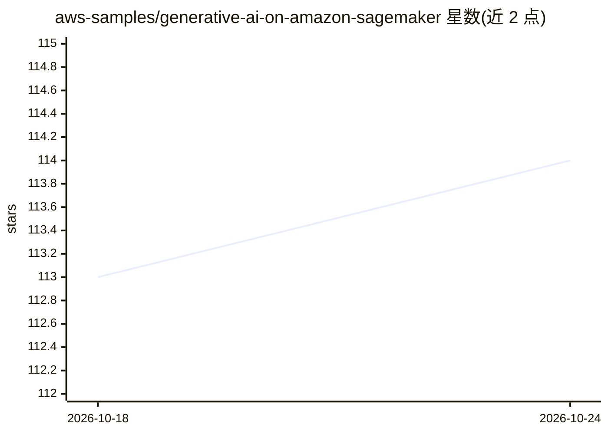

# aws-samples/generative-ai-on-amazon-sagemaker

⭐ 114 · Jupyter Notebook · MIT-0 · 推送 2026-10-20 · [GitHub](https://github.com/aws-samples/generative-ai-on-amazon-sagemaker) · 组织维护

**SageMaker/Bedrock 生成式 AI 示例与工作坊合集**

AWS 官方 samples 仓库，汇集在 Amazon SageMaker AI 与 Amazon Bedrock 上实践生成式 AI 的示例代码与工作坊，内容覆盖 RAG 应用构建、模型微调（SFT/DPO/RLVR/RLAIF、LoRA、FSDP）、Agent 模式（LangGraph/CrewAI/Strands）、模型评测（LightEval、LLM-as-a-Judge）与责任 AI（Bedrock Guardrails）。使用方式为克隆仓库后进入各工作坊目录，按其 README 运行 Jupyter notebook。需要 AWS 账号及 SageMaker、Bedrock 服务访问权限，代码以 MIT-0 许可发布。

## 筛选速览

| 维度 | 判定 | 备注 |
|---|---|---|
| AI 角色 | `ai-knowledge` | 知识聚合/清单类 |
| 许可风险 | `permissive` | MIT-0 |
| 部署形态 | `None` |  |
| 模型依赖 | — | README 未给出锁定关系 |
| 硬件要求 | — | 无带数字的原话,不猜 |
| 安装摩擦 | `low` | 无编译、无系统依赖或容器化 |
| 成熟度 | — | 结构信号不足 |

## 能力要点

- 覆盖 RAG、微调、Agent、评测、责任 AI 等多个主题的工作坊
- 微调技术含 SFT/DPO/RLVR/RLAIF 与 LoRA、FSDP 分布式策略
- 模型可用 DJL LMI 与 vLLM 部署到 SageMaker 实时端点
- 各工作坊由 Jupyter notebook 逐步引导

## 适用场景

- 学习在 SageMaker 上微调与部署基础模型
- 参考 Bedrock 构建 RAG 应用与 Agent 的示例代码
- 了解 SageMaker 上的模型评测与 Guardrails 实践

## 场景标签

`教程课程` · 领域:学习与行业

## 证据(README 行号)

> L3: This repository provides comprehensive resources for working with generative AI models using Amazon SageMaker and Am
> L65: ## Getting Started

## 星数曲线

2026-10-18 113 → 2026-10-24 114（+1）

---
*卡片 v1 · prompt 1.4 · 生成 2026-10-23 · 置信度 high · 依据 README sha `6cb84983299a` · [字段定义](../../DATASET.md)*
