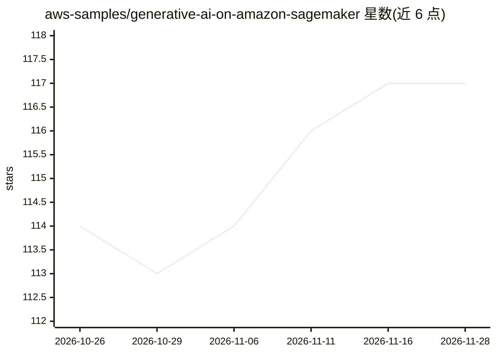

# aws-samples/generative-ai-on-amazon-sagemaker

⭐ 117 · Jupyter Notebook · MIT-0 · 推送 2026-11-24 · [GitHub](https://github.com/aws-samples/generative-ai-on-amazon-sagemaker) · 组织维护

**面向开发者的 SageMaker/Bedrock 生成式 AI 示例与教程集**

AWS 官方维护的示例仓库，围绕 Amazon SageMaker 与 Amazon Bedrock 组织成多个 workshop：RAG 工作流构建（OpenSearch、embedding 微调、guardrails）、模型定制（CPT/SFT/DPO、FSDP、LoRA、HyperPod）、Agent 开发（tool calling、LangGraph/CrewAI/Strands 等框架、Langfuse/MLflow 可观测性）、无服务器微调、数据治理到自定义模型的流程，以及 Comet/Fiddler/Deepchecks 等伙伴应用评测。使用方式为 clone 后按各 workshop 的 Jupyter notebook 操作，前提是拥有 AWS 账号及 SageMaker/Bedrock 服务访问权限。

## 筛选速览

| 维度 | 判定 | 备注 |
|---|---|---|
| AI 角色 | `ai-knowledge` | 知识聚合/清单类 |
| 许可风险 | `permissive` | MIT-0 |
| 部署形态 | `None` |  |
| 模型依赖 | locked-api |  |
| 硬件要求 | — | 无带数字的原话,不猜 |
| 安装摩擦 | `low` | 无编译、无系统依赖或容器化 |
| 成熟度 | — | 结构信号不足 |

## 能力要点

- 多个 workshop 覆盖 RAG、模型定制、Agent、评测四类流程
- 支持 CPT/SFT/DPO/RLVR/RLAIF 等微调技术示例
- 含 Amazon Nova 模型在 SageMaker 上的定制与部署示例
- 各 workshop 以 Jupyter notebook 形式提供分步指引

## 适用场景

- 在 SageMaker 上微调并部署基础模型
- 用 SageMaker 与 Bedrock 搭建 RAG 应用
- 学习构建带工具调用的 Agent 工作流
- 为 LLM 应用选择评测与监控工具链

## 场景标签

`教程课程` `RAG` `微调` `Agent 框架` · 领域:Agent 开发

## 证据(README 行号)

> L3: This repository provides comprehensive resources for working with generative AI models using Amazon SageMaker and Am
> L78: 4. Each workshop contains Jupyter notebooks that guide you through the process

## 星数曲线

2026-10-26 114 → 2026-11-28 117（+3）

---
*卡片 v1 · prompt 1.4 · 生成 2026-11-28 · 置信度 high · 依据 README sha `2a105d0d5d38` · [字段定义](../../DATASET.md)*
