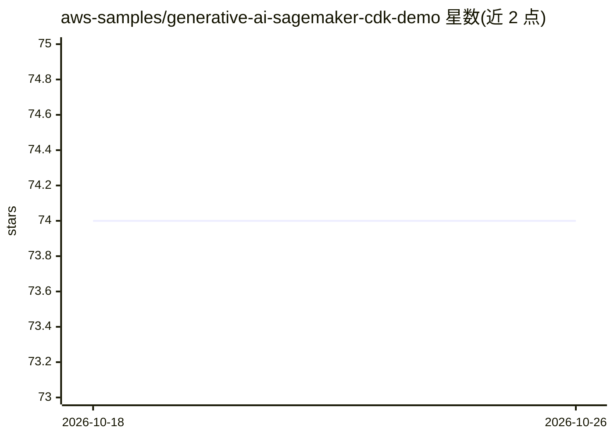

# aws-samples/generative-ai-sagemaker-cdk-demo

⭐ 74 · Python · MIT-0 · 推送 2026-07-28 · [GitHub](https://github.com/aws-samples/generative-ai-sagemaker-cdk-demo) · 组织维护

**用 AWS CDK 部署 SageMaker JumpStart 生成式 AI 模型的示例工程**

AWS 官方示例仓库：以 AWS CDK 基础设施即代码方式，在 SageMaker JumpStart 上部署 Stable Diffusion（文生图）与 FLAN-T5-XL（文本生成）两个模型端点，并经 API Gateway 与 Lambda 供一个部署在 ECS/Fargate 上的 Streamlit Web 应用调用。提供分步部署流程（VPC、Web、模型端点三个堆栈）。面向有 AWS 账号的开发者，需 AWS CLI、CDK v2、Node.js、Docker 等前置条件，预计运行 8 小时成本约 50 美元，在 us-east-1 测试。

## 筛选速览

| 维度 | 判定 | 备注 |
|---|---|---|
| AI 角色 | `ai-ecosystem` | LLM/agent 周边工具 |
| 许可风险 | `permissive` | MIT-0 |
| 部署形态 | `self-host` | docker 或自建部署 |
| 模型依赖 | — | README 未给出锁定关系 |
| 硬件要求 | — | 无带数字的原话,不猜 |
| 安装摩擦 | `low` | 无编译、无系统依赖或容器化 |
| 成熟度 | — | 结构信号不足 |

## 能力要点

- CDK 三个堆栈：VPC 网络、Streamlit Web 应用、JumpStart 模型端点
- 演示 Stable Diffusion 文生图与 FLAN-T5-XL 文本生成
- Web 应用经 API Gateway + Lambda 调用 SageMaker 端点
- 端点使用 ml.g4dn.4xlarge 推理实例（app.py 中指定）

## 适用场景

- 参考如何在 AWS 上以 IaC 方式部署生成式模型
- 搭建可演示的文生图/文本生成 Web 应用
- 学习 SageMaker JumpStart 与 CDK 的组合使用

## 场景标签

`图像生成` `推理引擎` · 领域:内容生成

## 证据(README 行号)

> L1: # Deploy generative AI models from Amazon SageMaker JumpStart using the AWS CDK
> L23: In this post, we show how to deploy image and text generative AI models from JumpStart using the AWS Cloud Developm
> L25: We use the Stable Diffusion model for image generation and the FLAN-T5-XL model for natural language understanding 

## 星数曲线

2026-10-18 74 → 2026-10-26 74（+0）

---
*卡片 v1 · prompt 1.4 · 生成 2026-10-24 · 置信度 mid · 依据 README sha `83bbc8ee5323` · [字段定义](../../DATASET.md)*
