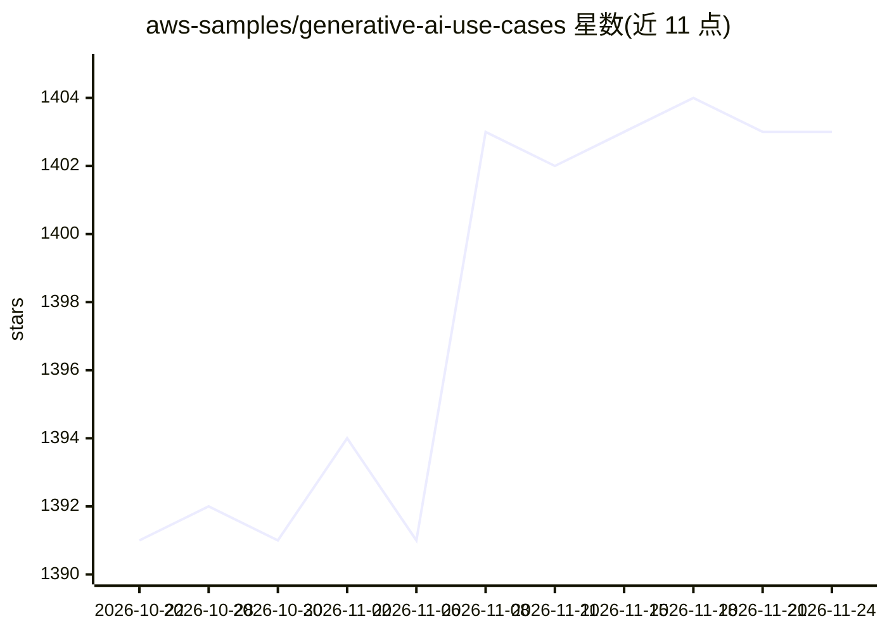

# aws-samples/generative-ai-use-cases

⭐ 1,403 · TypeScript · MIT-0 · 推送 2026-11-23 · [GitHub](https://github.com/aws-samples/generative-ai-use-cases) · [官网](https://aws-samples.github.io/generative-ai-use-cases/en/) · 组织维护

**面向企业的生成式 AI 业务用例参考应用（部署在 AWS）**

aws-samples 维护的参考应用 GenU：以 AWS CDK 部署到 AWS 云端，面向企业员工提供聊天、文本生成、摘要、会议纪要、翻译、图像/视频生成、语音对话、RAG 聊天等一组业务用例。机制上以 Knowledge Bases for Amazon Bedrock 作为 RAG 信息源，支持 Agent Builder 无代码创建 agent、Use Case Builder 用自然语言模板生成自定义用例，并提供按用户的 token 用量与成本统计、SAML 认证与 VPC 内网部署选项。部署需 CDK 环境，费用按 AWS 按量计费。

## 筛选速览

| 维度 | 判定 | 备注 |
|---|---|---|
| AI 角色 | `ai-native` | 本体是模型或模型工具 |
| 许可风险 | `permissive` | MIT-0 |
| 部署形态 | `library` | 以包/库形式分发 |
| 模型依赖 | locked-api |  |
| 硬件要求 | — | 无带数字的原话,不猜 |
| 安装摩擦 | `low` | 无编译、无系统依赖或容器化 |
| 成熟度 | — | 结构信号不足 |

## 能力要点

- 一组内置生成式 AI 用例：聊天/摘要/翻译/会议纪要/图像视频生成/语音对话
- RAG Chat 以 Knowledge Bases for Amazon Bedrock 为信息源，支持高级解析、查询分解与重排
- Agent Builder 与 Use Case Builder 无代码创建并共享 agent/自定义用例
- 按用户与用例的 token 用量、成本统计与 CloudWatch 监控，支持 SAML 与封闭网络模式

## 适用场景

- 在企业内安全地部署一套生成式 AI 工作台供员工使用
- 基于公司内部文档搭建 RAG 问答系统
- 无代码创建业务 agent 与自定义提示词用例并分发给同事
- 统计各部门生成式 AI 的用量与成本

## 场景标签

`聊天机器人` `图像生成` `视频生成` `RAG` · 领域:对话与助手

## 证据(README 行号)

> L5: Well-architected application implementation with business use cases for utilizing generative AI in business operatio
> L20: GenU provides a variety of standard use cases leveraging generative AI. These use cases can serve as seeds for idea
> L75: GenU provides a RAG Chat use case.

## 星数曲线

2026-10-22 1,391 → 2026-11-24 1,403（+12）

---
*卡片 v1 · prompt 1.4 · 生成 2026-11-24 · 置信度 high · 依据 README sha `f22c66a72ece` · [字段定义](../../DATASET.md)*
