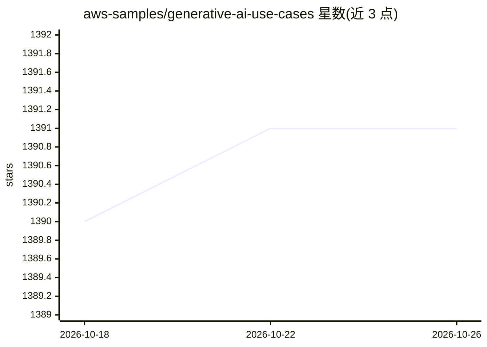

# aws-samples/generative-ai-use-cases

⭐ 1,391 · TypeScript · MIT-0 · 推送 2026-10-24 · [GitHub](https://github.com/aws-samples/generative-ai-use-cases) · [官网](https://aws-samples.github.io/generative-ai-use-cases/en/) · 组织维护

**面向企业内部安全使用生成式 AI 的业务应用平台**

AWS 官方 samples 出品的生成式 AI 业务应用（GenU）：以 Web 应用形式提供聊天、文本生成、摘要、会议纪要、翻译、图像/视频生成、语音对话、RAG 问答等内置用例，支持 Use Case Builder 用自然语言提示模板创建自定义用例并可导出 JSON 分享。RAG 信息源支持 Amazon Kendra 与 Knowledge Base，可启用 Web Search/Code Interpreter 等 Bedrock Agent 及 MCP 外部服务。通过 AWS CDK 部署到自有 AWS 账号，需先在 Bedrock 开通模型访问；README 附成本估算与企业案例。

## 筛选速览

| 维度 | 判定 | 备注 |
|---|---|---|
| AI 角色 | `ai-native` | 本体是模型或模型工具 |
| 许可风险 | `permissive` | MIT-0 |
| 部署形态 | `library` | 以包/库形式分发 |
| 模型依赖 | locked-api |  |
| 硬件要求 | — | 无带数字的原话,不猜 |
| 安装摩擦 | `low` | 无编译、无系统依赖或容器化 |
| 成熟度 | — | 结构信号不足 |

## 能力要点

- 聊天/摘要/翻译/图像/视频/语音等十余种内置生成式 AI 用例
- RAG 问答支持 Amazon Kendra 与 Knowledge Base（含高级解析、重排、元数据过滤）
- Use Case Builder 以提示模板生成自定义用例，无需改代码
- 可导入 Bedrock Agents / AgentCore / Bedrock Flows，并支持 MCP 外部服务

## 适用场景

- 在企业内部安全地部署一个生成式 AI 工作台供员工使用
- 基于公司内部文档（PDF/Word/Excel）搭建 RAG 问答
- 用自然语言提示模板快速创建并共享自定义业务用例
- 将自建的 Bedrock Agent 接入带 SAML 认证的内部分发平台

## 场景标签

`聊天机器人` `RAG` `图像生成` `视频生成` · 领域:对话与助手

## 证据(README 行号)

> L5: Well-architected application implementation with business use cases for utilizing generative AI in business operatio
> L28:  Chat
> L70: GenU provides a RAG Chat use case.

## 星数曲线

2026-10-18 1,390 → 2026-10-26 1,391（+1）

---
*卡片 v1 · prompt 1.4 · 生成 2026-10-21 · 置信度 high · 依据 README sha `6ffb6ff5320a` · [字段定义](../../DATASET.md)*
