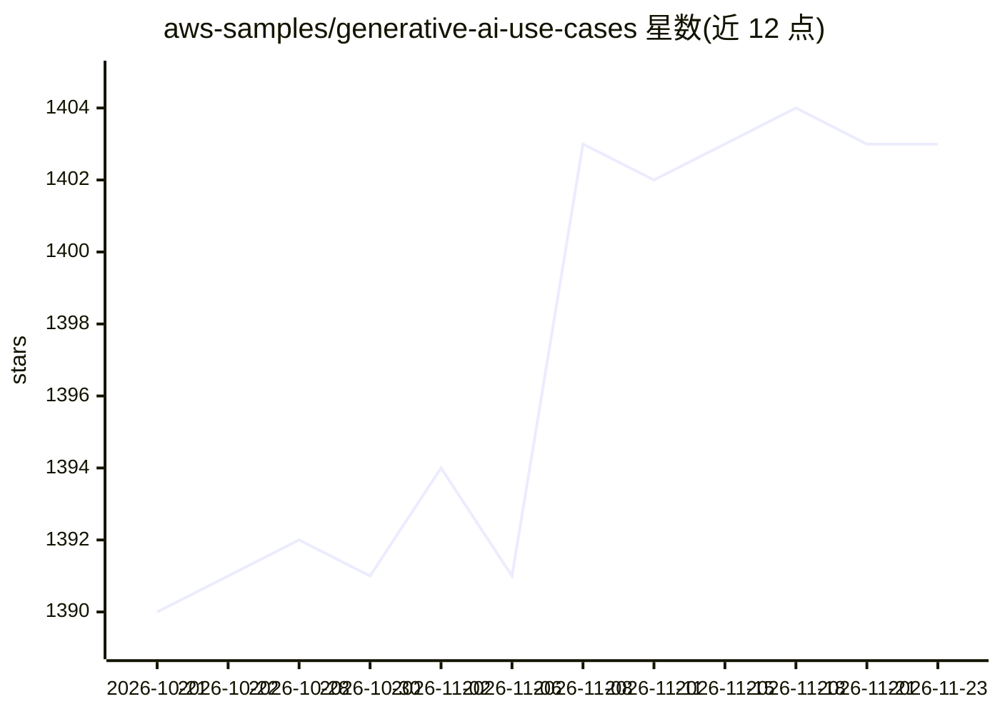

# aws-samples/generative-ai-use-cases

⭐ 1,403 · TypeScript · MIT-0 · 推送 2026-11-22 · [GitHub](https://github.com/aws-samples/generative-ai-use-cases) · [官网](https://aws-samples.github.io/generative-ai-use-cases/en/) · 组织维护 · 中文 README

**企业安全落地生成式 AI 的 AWS 参考应用（GenU）**

AWS 官方示例仓库 GenU，通过 AWS CDK 部署到企业环境的应用实现。默认提供聊天、文本生成、摘要、会议纪要、翻译、图像/视频生成、语音对话等用例，支持 RAG 聊天（Knowledge Base/Kendra）、Agent 导入（Bedrock Agents/AgentCore/Flows）与 MCP 外部服务接入；Use Case Builder 用自然语言提示模板创建自定义用例并共享。部署依赖 CDK 执行环境，需在 cdk.json 配置模型区域与模型访问。

## 筛选速览

| 维度 | 判定 | 备注 |
|---|---|---|
| AI 角色 | `ai-native` | 本体是模型或模型工具 |
| 许可风险 | `permissive` | MIT-0 |
| 部署形态 | `library` | 以包/库形式分发 |
| 模型依赖 | locked-api |  |
| 硬件要求 | — | 无带数字的原话,不猜 |
| 安装摩擦 | `low` | 无编译、无系统依赖或容器化 |
| 成熟度 | — | 结构信号不足 |

## 能力要点

- 内置聊天/摘要/翻译/会议纪要/图像视频生成等标准用例，可按选项隐藏
- RAG 聊天支持 Knowledge Base 与 Kendra，含解析、分块、重排等高级特性
- 支持导入 Bedrock Agents/AgentCore/Bedrock Flows，并可通过 MCP 接入外部服务
- Use Case Builder 由提示模板自动生成用例界面，支持 JSON 导出共享

## 适用场景

- 在企业内部安全地部署 LLM 聊天、翻译、摘要等日常用例
- 基于公司积累的文档构建 RAG 问答系统
- 把自建的 Bedrock Agent 在组织内统一分发使用
- 用提示模板快速创建并共享业务自定义机器人

## 场景标签

`聊天机器人` `RAG` `图像生成` `视频生成` · 领域:对话与助手

## 证据(README 行号)

> L5: Well-architected application implementation with business use cases for utilizing generative AI in business operatio
> L25: GenU provides a variety of standard use cases leveraging generative AI. These use cases can serve as seeds for idea
> L126: GenU deployment uses AWS Cloud Development Kit (CDK). If you cannot prepare a CDK execution environment, refer to 

## 星数曲线

2026-10-21 1,390 → 2026-11-23 1,403（+13）

---
*卡片 v1 · prompt 1.4 · 生成 2026-11-23 · 置信度 high · 依据 README sha `d8de1dbb15b3` · [字段定义](../../DATASET.md)*
