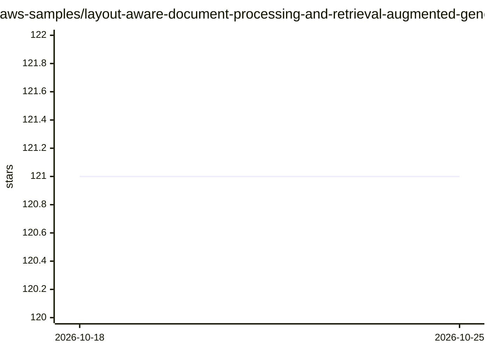

# aws-samples/layout-aware-document-processing-and-retrieval-augmented-generation

⭐ 121 · Jupyter Notebook · MIT-0 · 推送 2025-12-02 · [GitHub](https://github.com/aws-samples/layout-aware-document-processing-and-retrieval-augmented-generation) · 组织维护

**版面感知文档抽取与索引的示例 notebook：提升 RAG 检索**

AWS 官方 samples 仓库提供的示例 notebook，演示利用 Amazon Textract Layout 功能抽取文档内容，通过 Textractor 库以 XML 标签标注语义区块，再按标题/章节层级与最大词数阈值进行版面感知分块（表格逐行分块并附加表头、列表按条目分块并附加列表头、段落附加章节头），表格转 CSV 处理合并单元格，建立 chunk-section-chapter 层级元数据并索引到 OpenSearch 向量库，检索阶段用混合检索并按需把章节或章回传给 LLM。前置条件为 Bedrock 模型访问、SageMaker JumpStart 部署嵌入与生成模型、OpenSearch 域。

## 筛选速览

| 维度 | 判定 | 备注 |
|---|---|---|
| AI 角色 | `ai-knowledge` | 知识聚合/清单类 |
| 许可风险 | `permissive` | MIT-0 |
| 部署形态 | `None` |  |
| 模型依赖 | locked-api |  |
| 硬件要求 | — | 无带数字的原话,不猜 |
| 安装摩擦 | `low` | 无编译、无系统依赖或容器化 |
| 成熟度 | — | 结构信号不足 |

## 能力要点

- Textract Layout 抽取并保持文档版面与阅读顺序
- 针对表格/列表/章节的版面感知分块策略（保留表头、列表头、章节头）
- chunk-section-chapter 层级元数据，支持 Small2Big、Graph query 等检索技术
- OpenSearch 混合检索（语义+文本匹配）后按需选择回传的层级上下文

## 适用场景

- 处理含大量表格、列表、多层章节的文档并接入 RAG 问答
- 构建带层级上下文控制的检索系统，按查询调节送入 LLM 的信息量
- 在 AWS 上（Textract/SageMaker/OpenSearch）搭建文档知识库参考实现

## 场景标签

`RAG` `文档解析` · 领域:知识与检索

## 证据(README 行号)

> L7: This example notebook guides you through the process of utilizing Amazon Textract's layout feature. This feature all
> L22: This notebook utilizes the Textractor library to interact with Amazon Textract and interpret its response. It enric
> L49: In the RAG process, we retrieve the top K=n similar passages from the Vector Database (Amazon OpenSearch Service). 

## 星数曲线

2026-10-18 121 → 2026-10-25 121（+0）

---
*卡片 v1 · prompt 1.4 · 生成 2026-10-23 · 置信度 high · 依据 README sha `1bd7ea0fdbdf` · [字段定义](../../DATASET.md)*
