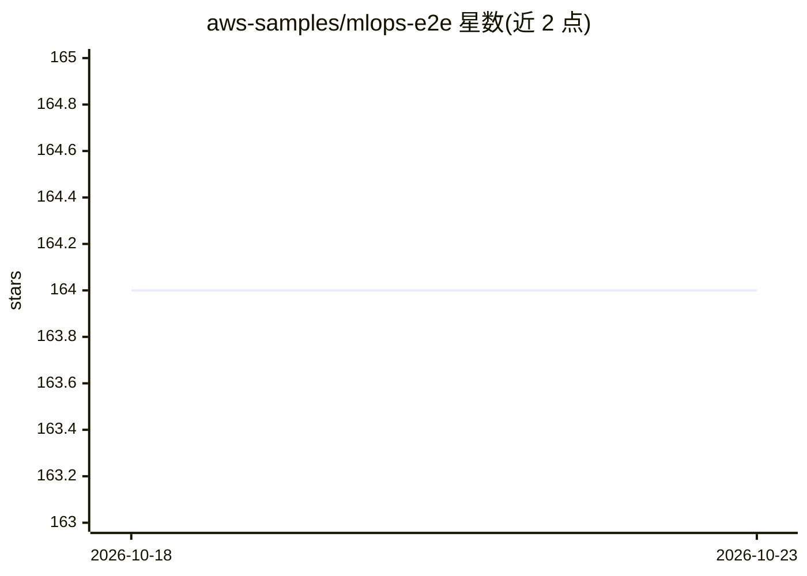

# aws-samples/mlops-e2e

⭐ 164 · TypeScript · MIT-0 · 推送 2026-04-15 · [GitHub](https://github.com/aws-samples/mlops-e2e) · 组织维护

**AWS 上的端到端 MLOps 示例：SageMaker+CodePipeline+CDK 实现 ML CI/CD**

aws-samples 维护的示例工程，演示如何用 Amazon SageMaker Pipeline、AWS CodePipeline 与 AWS CDK 实现机器学习的 CI/CD：源码或数据更新触发流水线，执行 ML 代码测试与基础设施构建，SageMaker Pipeline 完成预处理、训练与评估，经人工审批后部署到 SageMaker 实时推理端点。附带 UCI 鲍鱼年龄预测回归项目作示例，含模型消费方示例。需要 AWS 账户且产生费用，通过 bootstrap 脚本一键部署。

## 筛选速览

| 维度 | 判定 | 备注 |
|---|---|---|
| AI 角色 | `ai-ecosystem` | LLM/agent 周边工具 |
| 许可风险 | `permissive` | MIT-0 |
| 部署形态 | `library` | 以包/库形式分发 |
| 模型依赖 | — | README 未给出锁定关系 |
| 硬件要求 | — | 无带数字的原话,不猜 |
| 安装摩擦 | `low` | 无编译、无系统依赖或容器化 |
| 成熟度 | — | 结构信号不足 |

## 能力要点

- 代码或数据变更自动触发 CodePipeline 跑 CI 与 SageMaker 训练流水线
- 人工审批门控的模型部署到 SageMaker 实时端点
- AWS CDK 定义全部基础设施，含数据 S3 桶监控与 manifest 生成
- 推理管线模型复用训练期预处理器直接处理原始输入

## 适用场景

- 参考如何在 AWS 上搭建 ML 模型的 CI/CD 流水线
- 学习 SageMaker Pipeline 与 CodePipeline、CDK 的集成方式
- 以鲍鱼年龄预测示例跑通从数据到端点部署的完整流程

## 场景标签

`MLOps` · 领域:训练与推理

## 证据(README 行号)

> L3: This sample project uses a sample machine learning project to showcase how we can implement MLOps - CI/CD for Machin
> L137: When there is a new version of source code or there is a new version of data, the CodePipeline (serving as MLOps p

## 星数曲线

2026-10-18 164 → 2026-10-23 164（+0）

---
*卡片 v1 · prompt 1.4 · 生成 2026-10-22 · 置信度 mid · 依据 README sha `0a4e3cb19b54` · [字段定义](../../DATASET.md)*
