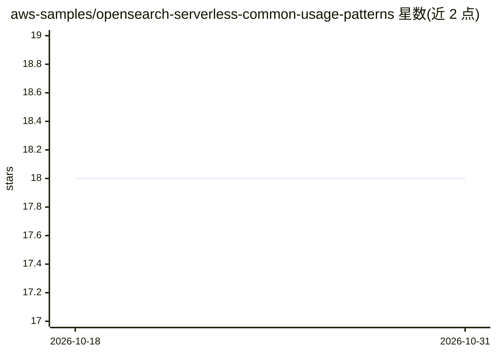

# aws-samples/opensearch-serverless-common-usage-patterns

⭐ 18 · Python · MIT-0 · 推送 2026-03-26 · [GitHub](https://github.com/aws-samples/opensearch-serverless-common-usage-patterns) · 组织维护

**Amazon OpenSearch Serverless 常见使用模式的示例项目集合**

由 aws-samples 维护的示例项目仓库，展示 Amazon OpenSearch Serverless 的多种使用模式：搜索、时间序列分析、向量检索、VPC 内部署以及通过 Kinesis Data Firehose 流式数据摄取。每个模式对应一个独立示例工程并附架构说明。面向希望在 AWS 上搭建搜索或向量检索服务的开发者，提供参考实现而非可直接安装的产品。

## 筛选速览

| 维度 | 判定 | 备注 |
|---|---|---|
| AI 角色 | `ai-ecosystem` | LLM/agent 周边工具 |
| 许可风险 | `permissive` | MIT-0 |
| 部署形态 | `None` |  |
| 模型依赖 | — | README 未给出锁定关系 |
| 硬件要求 | — | 无带数字的原话,不猜 |
| 安装摩擦 | `low` | 无编译、无系统依赖或容器化 |
| 成熟度 | — | 结构信号不足 |

## 能力要点

- 覆盖搜索、时间序列、向量检索等 5 种使用模式
- 含 VPC 内部署 OpenSearch Serverless 的架构示例
- 含 Kinesis Data Firehose 流式摄取数据示例

## 适用场景

- 参考示例在 AWS 上搭建 OpenSearch Serverless 搜索或向量检索服务
- 学习 Firehose 到 OpenSearch Serverless 的数据摄取架构
- 了解 VPC 环境下访问 OpenSearch Serverless 的方式

## 场景标签

`向量数据库` `语义搜索` · 领域:知识与检索

## 证据(README 行号)

> L3: This repository contains a set of example projects for Amazon OpenSearch Serverless
> L9: |Opensearch Serverless for Vector Search usecases|opensearch-serverless-vector-search-type|opensearch serverless for

## 星数曲线

2026-10-18 18 → 2026-10-31 18（+0）

---
*卡片 v1 · prompt 1.4 · 生成 2026-10-29 · 置信度 mid · 依据 README sha `f9696563b22c` · [字段定义](../../DATASET.md)*
