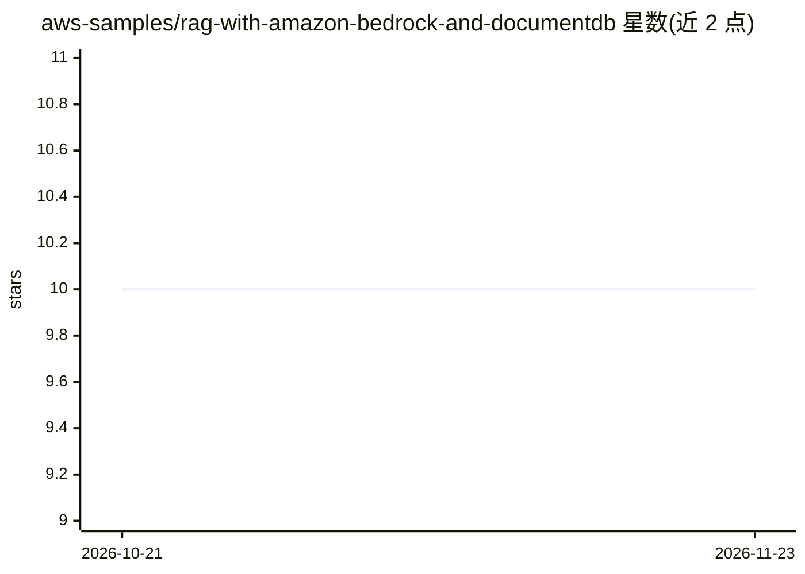

# aws-samples/rag-with-amazon-bedrock-and-documentdb

⭐ 10 · Jupyter Notebook · MIT-0 · 推送 2026-03-26 · [GitHub](https://github.com/aws-samples/rag-with-amazon-bedrock-and-documentdb) · 组织维护

**基于 Amazon Bedrock 与 DocumentDB 的企业知识库 RAG 问答应用**

AWS 官方示例工程，构建基于检索增强生成（RAG）的问答应用：以 Amazon DocumentDB（MongoDB 兼容）存储向量嵌入并作为知识库，检索相关文档片段后与用户请求组合为 prompt 发送至 LLM（经 Amazon Bedrock）生成回答。部署方式为 CDK 栈（含 DocumentDB 与 SageMaker Studio），数据摄取与问答流程在 JupyterLab notebook 中运行，前端使用 Streamlit。

## 筛选速览

| 维度 | 判定 | 备注 |
|---|---|---|
| AI 角色 | `ai-native` | 本体是模型或模型工具 |
| 许可风险 | `permissive` | MIT-0 |
| 部署形态 | `None` |  |
| 模型依赖 | locked-api |  |
| 硬件要求 | — | 无带数字的原话,不猜 |
| 安装摩擦 | `low` | 无编译、无系统依赖或容器化 |
| 成熟度 | — | 结构信号不足 |

## 能力要点

- Amazon DocumentDB 向量检索作为企业知识库
- RAG 流程：检索相关片段作为上下文送入 LLM 生成回答
- CDK 栈一键部署 DocumentDB 与 SageMaker Studio 环境
- 提供数据摄取 notebook 与 Streamlit 问答应用

## 适用场景

- 在企业内部文档上搭建问答应用
- 在 AWS 上体验 Bedrock + DocumentDB 的 RAG 架构
- 作为自有 RAG 系统的部署参考模板

## 场景标签

`RAG` `文档问答` · 领域:知识与检索

## 证据(README 行号)

> L3: This project is a Question Answering application with Large Language Models (LLMs) and Amazon DocumentDB (with Mongo
> L7: In this project, Amazon DocumentDB (with MongoDB Compatibility) is used for knowledge base.

## 星数曲线

2026-10-21 10 → 2026-11-23 10（+0）

---
*卡片 v1 · prompt 1.4 · 生成 2026-11-19 · 置信度 high · 依据 README sha `bd05032bf092` · [字段定义](../../DATASET.md)*
