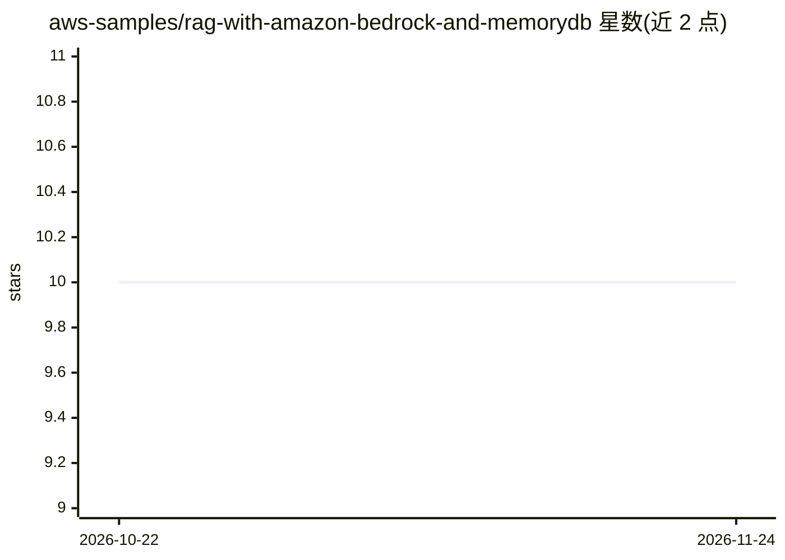

# aws-samples/rag-with-amazon-bedrock-and-memorydb

⭐ 10 · Jupyter Notebook · MIT-0 · 推送 2026-03-26 · [GitHub](https://github.com/aws-samples/rag-with-amazon-bedrock-and-memorydb) · 组织维护

**基于 Amazon Bedrock 与 MemoryDB 的 RAG 问答示例应用**

AWS 官方示例仓库：以 Amazon MemoryDB for Redis 作为向量知识库存储嵌入，采用 RAG 方式检索企业文档中的相关片段并作为上下文发给 LLM 生成回答。部署方式为通过 AWS CDK 创建 MemoryDB 与 SageMaker Studio 栈，在 SageMaker JupyterLab 中克隆仓库、运行数据摄取 notebook，最后运行 Streamlit 前端。属于应用范例而非生产级组件，依赖 AWS 云环境。

## 筛选速览

| 维度 | 判定 | 备注 |
|---|---|---|
| AI 角色 | `ai-native` | 本体是模型或模型工具 |
| 许可风险 | `permissive` | MIT-0 |
| 部署形态 | `None` |  |
| 模型依赖 | locked-api |  |
| 硬件要求 | — | 无带数字的原话,不猜 |
| 安装摩擦 | `low` | 无编译、无系统依赖或容器化 |
| 成熟度 | — | 结构信号不足 |

## 能力要点

- MemoryDB for Redis 作为向量知识库存储嵌入
- CDK 栈一键部署 MemoryDB 与 SageMaker Studio
- Jupyter notebook 数据摄取 + Streamlit 问答前端

## 适用场景

- 在企业文档上搭建 LLM 问答原型
- 评估 MemoryDB 向量检索在 RAG 中的效果
- 参考该架构部署自己的 RAG 应用

## 场景标签

`RAG` · 领域:知识与检索

## 证据(README 行号)

> L3: This project is a Question Answering application with Large Language Models (LLMs) and Amazon MemoryDB for Redis. An
> L7: In this project, Amazon MemoryDB for Redis is used for knowledge base.

## 星数曲线

2026-10-22 10 → 2026-11-24 10（+0）

---
*卡片 v1 · prompt 1.4 · 生成 2026-11-19 · 置信度 mid · 依据 README sha `0a8988bf0133` · [字段定义](../../DATASET.md)*
