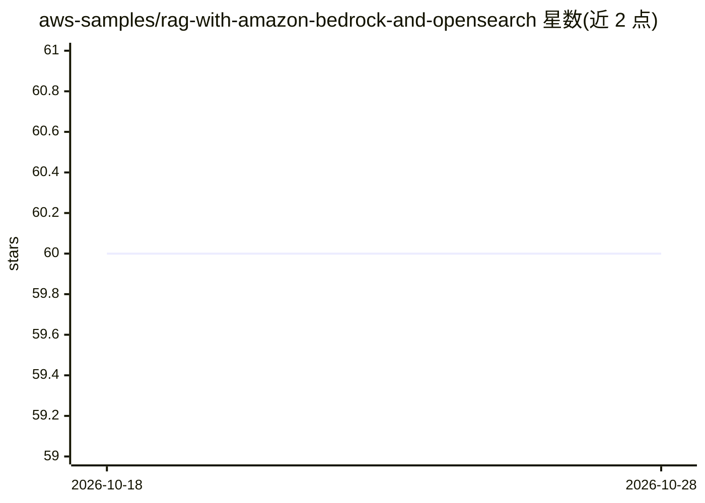

# aws-samples/rag-with-amazon-bedrock-and-opensearch

⭐ 60 · Python · MIT-0 · 推送 2026-04-05 · [GitHub](https://github.com/aws-samples/rag-with-amazon-bedrock-and-opensearch) · 组织维护

**用 Amazon Bedrock 和 OpenSearch 部署 RAG 应用的 AWS 示例项目**

AWS 官方 samples 仓库下的参考实现：以 Amazon Bedrock 托管基础模型为生成端，OpenSearch 作为开源向量库（替代 Kendra/Bedrock Knowledgebases），配合 LangChain 框架、S3 事件触发的 PDF 文本抽取 Lambda 链路、SQS 解耦、ECS 运行 Streamlit 前端、ALB 与 Cognito 认证，通过 AWS CDK 多栈部署。知识库限定为 S3 桶中的 PDF；嵌入默认使用 OpenAI Embeddings，需自备 OpenAI API Key 并承担其计费，也可改为 HuggingFace 或 Amazon Titan（需改代码）。

## 筛选速览

| 维度 | 判定 | 备注 |
|---|---|---|
| AI 角色 | `ai-ecosystem` | LLM/agent 周边工具 |
| 许可风险 | `permissive` | MIT-0 |
| 部署形态 | `library` | 以包/库形式分发 |
| 模型依赖 | locked-api |  |
| 硬件要求 | — | 无带数字的原话,不猜 |
| 安装摩擦 | `low` | 无编译、无系统依赖或容器化 |
| 成熟度 | — | 结构信号不足 |

## 能力要点

- Bedrock 提供模型 API，OpenSearch 作为开源向量库
- S3 事件通知 + Lambda + SQS 自动抽取 PDF 文本并更新索引
- AWS CDK 基础设施即代码，多栈分步部署
- Streamlit 前端 + Cognito 认证 + ALB HTTPS 接入

## 适用场景

- 在自有 AWS 环境搭建基于 Bedrock 的 PDF 知识库问答
- 参考无服务器化的 PDF 摄取与向量索引管线
- 学习 CDK 部署 RAG 架构的完整流程

## 场景标签

`RAG` `文档问答` · 领域:知识与检索

## 证据(README 行号)

> L3: Opinionated sample on how to configure and deploy RAG (Retrieval Augmented Generation) application.
> L7: * Amazon Bedrock as the managed service providing easy API based access to foundation models (FMs).
> L63: This project is divided into a few sub-stacks, so deploying it also requires a few additional steps. It uses AWS CD

## 星数曲线

2026-10-18 60 → 2026-10-28 60（+0）

---
*卡片 v1 · prompt 1.4 · 生成 2026-10-24 · 置信度 mid · 依据 README sha `4033c5b525c0` · [字段定义](../../DATASET.md)*
