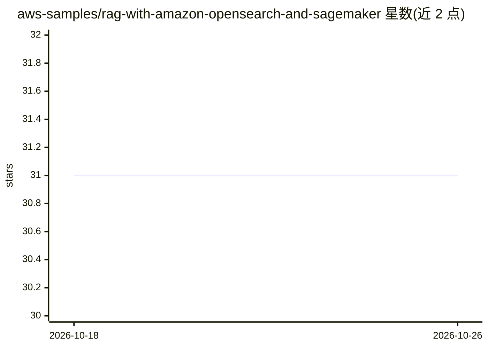

# aws-samples/rag-with-amazon-opensearch-and-sagemaker

⭐ 31 · Python · MIT-0 · 推送 2026-03-26 · [GitHub](https://github.com/aws-samples/rag-with-amazon-opensearch-and-sagemaker) · 组织维护

**基于 SageMaker 与 OpenSearch 的 RAG 问答应用示例**

AWS 官方示例项目：以 Amazon OpenSearch Service 作向量知识库存储 embedding，部署两个 SageMaker 端点分别负责文本生成与 embedding 生成，通过 CDK 栈部署基础设施，在 SageMaker Studio 的 JupyterLab 中克隆代码、运行数据摄取 notebook，最后以 Streamlit 应用交付 GenAI 问答。检索流程为从企业知识库中选取相关段落拼入 prompt 后送 LLM。面向希望在 AWS 上搭建 RAG 应用的开发者。

## 筛选速览

| 维度 | 判定 | 备注 |
|---|---|---|
| AI 角色 | `ai-native` | 本体是模型或模型工具 |
| 许可风险 | `permissive` | MIT-0 |
| 部署形态 | `None` |  |
| 模型依赖 | — | README 未给出锁定关系 |
| 硬件要求 | — | 无带数字的原话,不猜 |
| 安装摩擦 | `low` | 无编译、无系统依赖或容器化 |
| 成熟度 | — | 结构信号不足 |

## 能力要点

- CDK 一键部署 SageMaker 端点与 OpenSearch 集群
- OpenSearch 存储向量 embedding 作为 RAG 知识库
- Streamlit 应用提供问答界面

## 适用场景

- 在 AWS 上搭建企业知识库问答应用
- 参考 SageMaker 端点 + OpenSearch 的 RAG 架构实现

## 场景标签

`RAG` · 领域:知识与检索

## 证据(README 行号)

> L3: This project is a Question Answering application with Large Language Models (LLMs) and Amazon OpenSearch Service. An
> L16:  - A SageMaker Endpoint for text generation.

## 星数曲线

2026-10-18 31 → 2026-10-26 31（+0）

---
*卡片 v1 · prompt 1.4 · 生成 2026-10-26 · 置信度 high · 依据 README sha `69318649d79c` · [字段定义](../../DATASET.md)*
