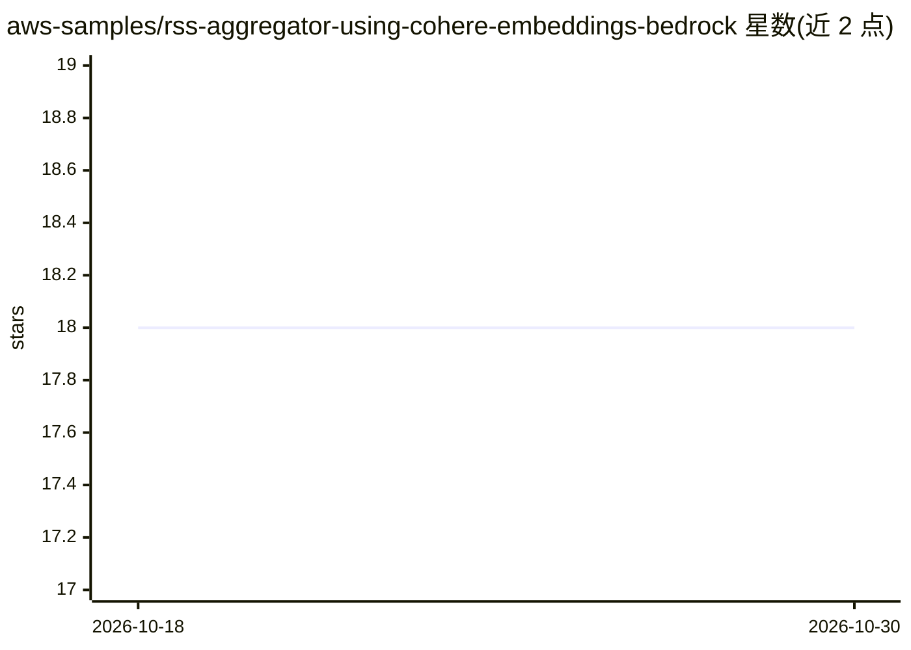

# aws-samples/rss-aggregator-using-cohere-embeddings-bedrock

⭐ 18 · TypeScript · MIT-0 · 推送 2026-02-11 · [GitHub](https://github.com/aws-samples/rss-aggregator-using-cohere-embeddings-bedrock) · [官网](https://djwtmt1np1xe4.cloudfront.net) · 组织维护

**AWS 示例应用：用 Cohere 嵌入与 Bedrock 做 RSS 聚合语义搜索与分类**

aws-samples 出品的演示型全栈 Web 应用：用户订阅 RSS 源，文章经 Amazon Bedrock 调用 Cohere v3 Embed 生成嵌入向量，实现零样本主题分类（默认及自定义主题）与语义搜索（可按语气、风格筛选）。架构全部采用 AWS 无服务器组件：API Gateway、Lambda（Fastify/TypeScript）、Aurora PostgreSQL + pgvector 向量存储、EventBridge/SQS 事件驱动、Cognito 认证。通过 AWS CDK 部署，需自有 AWS 账号、VPC 与 Cohere 模型访问权限；README 明确声明仅供教育用途、不适用于生产。

## 筛选速览

| 维度 | 判定 | 备注 |
|---|---|---|
| AI 角色 | `ai-native` | 本体是模型或模型工具 |
| 许可风险 | `permissive` | MIT-0 |
| 部署形态 | `None` |  |
| 模型依赖 | locked-api |  |
| 硬件要求 | — | 无带数字的原话,不猜 |
| 安装摩擦 | `low` | 无编译、无系统依赖或容器化 |
| 成熟度 | — | 结构信号不足 |

## 能力要点

- Cohere v3 嵌入实现文章零样本分类与语义搜索
- Aurora PostgreSQL + pgvector 作为向量存储
- 全无服务器架构（Lambda/EventBridge/SQS/API Gateway）
- 提供 CDK 一键部署与 CloudFront 在线演示

## 适用场景

- 学习嵌入向量在分类与语义搜索中的实际应用
- 参考 AWS 无服务器 + Bedrock + pgvector 的参考架构
- 基于示例代码改造自己的 RSS 聚合服务

## 场景标签

`语义搜索` `教程课程` · 领域:知识与检索

## 证据(README 行号)

> L9: This application is a complete web application that demonstrates the use of Language Embeddings, namely Cohere V3 Em
> L37: * **Amazon Bedrock with Cohere v3 Embed** – The articles and topics are converted into embeddings with the help of 

## 星数曲线

2026-10-18 18 → 2026-10-30 18（+0）

---
*卡片 v1 · prompt 1.4 · 生成 2026-10-29 · 置信度 high · 依据 README sha `6cf2cd28f3a1` · [字段定义](../../DATASET.md)*
