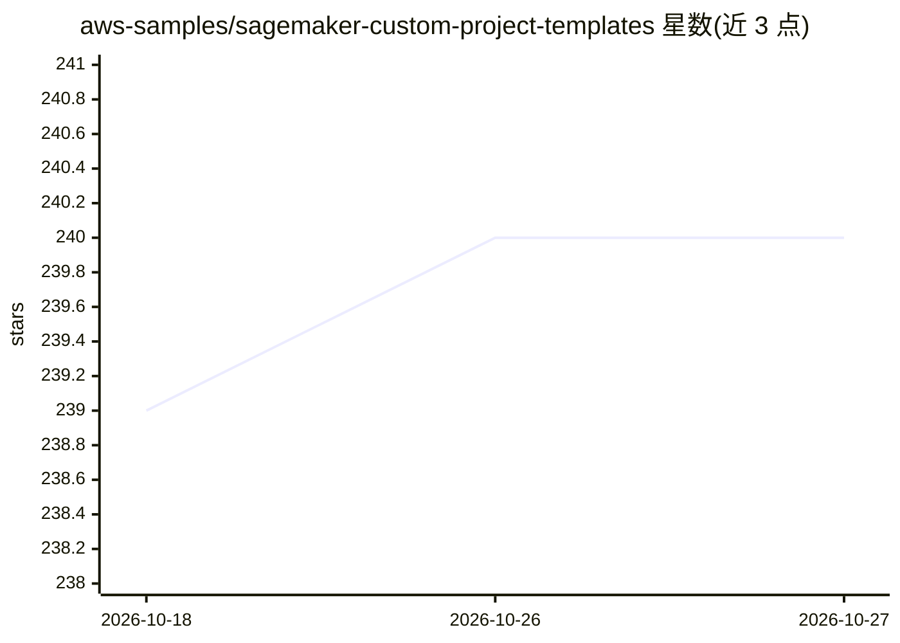

# aws-samples/sagemaker-custom-project-templates

⭐ 240 · Python · MIT-0 · 推送 2026-04-21 · [GitHub](https://github.com/aws-samples/sagemaker-custom-project-templates) · [官网](https://docs.aws.amazon.com/sagemaker/latest/dg/sagemaker-projects-whatis.html) · 组织维护

**为 SageMaker AI Projects 提供自定义 MLOps 项目模板集合**

aws-samples 仓库，收录用于 Amazon SageMaker AI Projects 的自定义项目模板，覆盖数据科学家开发环境标准化与 MLOps CI/CD 配置。支持两种部署方式：从 Amazon S3 桶直接部署（官方推荐）或经 AWS Service Catalog 部署；后者通过 CloudFormation 创建 Portfolio、添加产品、再在 SageMaker Studio 组织模板中选择创建项目。每个模板文件夹附带说明与各自的参数配置文档。

## 筛选速览

| 维度 | 判定 | 备注 |
|---|---|---|
| AI 角色 | `ai-ecosystem` | LLM/agent 周边工具 |
| 许可风险 | `permissive` | MIT-0 |
| 部署形态 | `None` |  |
| 模型依赖 | — | README 未给出锁定关系 |
| 硬件要求 | — | 无带数字的原话,不猜 |
| 安装摩擦 | `low` | 无编译、无系统依赖或容器化 |
| 成熟度 | — | 结构信号不足 |

## 能力要点

- 自定义 SageMaker 项目模板集合，每文件夹一个模板及说明
- 两种部署途径：Amazon S3 直连与 AWS Service Catalog
- Service Catalog 部署含分步 CloudFormation 操作指引

## 适用场景

- 在组织中标准化 SageMaker 机器学习项目脚手架
- 为 MLOps 团队快速配置带 CI/CD 的项目模板
- 通过组织模板在 Studio 中创建可复用项目

## 场景标签

`MLOps` · 领域:训练与推理

## 证据(README 行号)

> L3: This repository contains custom SageMaker AI Project templates. You can be deploy custom templates with two differen
> L14: You have two deployment options to deploy the custom MLOps templates using SageMaker AI Projects:

## 星数曲线

2026-10-18 239 → 2026-10-27 240（+1）

---
*卡片 v1 · prompt 1.4 · 生成 2026-10-22 · 置信度 high · 依据 README sha `10b75e43b877` · [字段定义](../../DATASET.md)*
